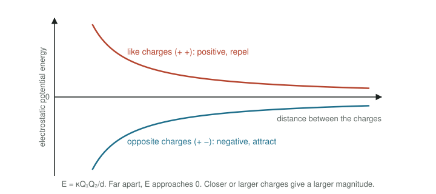

## 1. Energy, work, and heat (1.4)

**Energy** is the capacity to do work or to transfer heat.

- **Work** is energy used to move an object against a force: lifting a book, or a gas pushing back a
  piston.
- **Heat** is energy transferred from a hotter object to a colder one.

Chemistry tracks energy because every reaction either releases it (burning fuel) or absorbs it (cooking
an egg). Chapter 5 measures those energy changes. This chapter sets up the vocabulary.

## 2. Kinetic and potential energy (1.4)

**Kinetic energy** is energy of motion:

$$
E_k = \tfrac{1}{2} m v^2
$$

A heavier object, or a faster one, has more kinetic energy. Doubling the speed **quadruples** it.

**Potential energy** is stored energy that depends on position relative to other objects. A rock on a
cliff has gravitational potential energy; when it falls, that potential energy turns into kinetic
energy. Energy changes form, but the total stays the same (energy is conserved).

At the particle level, the motion of atoms and molecules is kinetic energy, and **temperature** is a
measure of their average kinetic energy. The energy stored in the arrangement of charged particles
(electrons and nuclei) is potential energy, and it's where **chemical energy** comes from.

## 3. Electrostatic potential energy

Atoms are made of charged particles, so the most important potential energy in chemistry comes from
the attraction and repulsion of charges:

$$
E_{\text{el}} = \frac{\kappa\, Q_1 Q_2}{d}
$$

$Q_1$ and $Q_2$ are the charges, $d$ is the distance between them, and $\kappa$ is a constant
($8.99 \times 10^9\ \text{J·m/C}^2$).

- **Opposite charges** (+ and −): $Q_1 Q_2$ is negative, so $E_{\text{el}}$ is negative. The energy
  gets **lower** (more negative) as they move **closer**, so they attract.
- **Like charges**: $E_{\text{el}}$ is positive and gets **higher** as they move closer, so they repel.
- **Larger charges** or a **smaller distance** give a larger magnitude.

Systems tend to move toward lower energy. An electron is pulled toward a nucleus, a positive ion toward a
negative one, and the energy released when they come together is what holds atoms in molecules and ions
in crystals.

<Callout type="ap-tip">
Coulomb's law comes back throughout the course: why electrons in inner shells are harder to remove
(Ch. 6–7), why MgO has a far higher melting point than NaCl (Ch. 8), and the strength of attractions
between molecules (Ch. 11). AP answers usually just need the two factors: **size of the charges** and
**distance between them**.
</Callout>

<Reveal label="Worked example: compare two attractions">

Which pair of ions has the more negative (stronger) electrostatic potential energy: a +1 ion and a −1
ion 0.30 nm apart, or a +2 ion and a −2 ion 0.40 nm apart?

Compare $Q_1 Q_2 / d$ (the constant is the same for both):

- $(+1)(-1) / 0.30 = -3.3$
- $(+2)(-2) / 0.40 = -10$

The +2/−2 pair is about **three times** stronger, even though it's farther apart. Quadrupling the
charge product matters more than the 33% increase in distance.

</Reveal>

## 4. Units of energy (1.5)

The SI unit of energy is the **joule** (J): $1\ \text{J} = 1\ \text{kg·m}^2/\text{s}^2$, the kinetic
energy of a 2 kg mass moving at 1 m/s. Chemical energy changes are usually given in kilojoules
(kJ).

<Reveal label="Worked example: kinetic energy in joules">

A 145 g baseball is thrown at 40.0 m/s. What is its kinetic energy in joules?

Mass must be in kilograms for joules: $145\ \text{g} = 0.145\ \text{kg}$.

$$
E_k = \tfrac{1}{2}(0.145\ \text{kg})(40.0\ \text{m/s})^2 = 116\ \text{J}
$$

</Reveal>

### System and surroundings

To track energy, split the world in two. The **system** is the part being studied (the chemicals in a
flask); the **surroundings** are everything else. In Chapter 5, energy flowing out of the system
(an exothermic process) and into it (an endothermic process) is measured as heat.

<Callout type="note">
The AP course doesn't list Section 1.4 as its own topic, but kinetic energy and temperature return
in Unit 3 (gases) and Unit 6 (thermochemistry), and Coulomb's law is part of topic 1.5.
</Callout>
