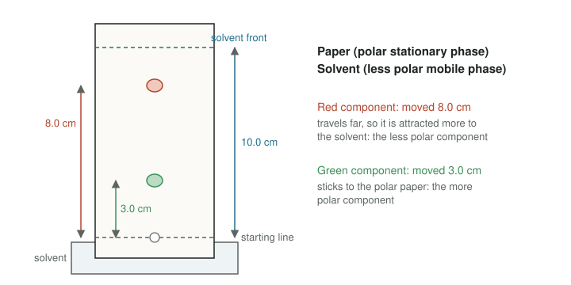

## 1. States of matter (1.2)

Chemistry explains what we see (the **macroscopic** level) with what atoms and molecules are doing
(the **particulate** level). The three common states show the idea:

| State | Shape | Volume | Particles |
|---|---|---|---|
| **Solid** | fixed | fixed | packed close together, vibrating in place |
| **Liquid** | takes the container's shape | fixed | close together, but slide past each other |
| **Gas** | fills the container | fills the container | far apart, moving fast; easy to compress |

## 2. Pure substances and mixtures (1.2)

A **pure substance** has a fixed composition: every sample is made of the same particles.

- An **element** can't be broken into simpler substances. Its particles are one kind of atom, either
  as separate atoms (He, Fe) or as molecules ($\ce{O2}$, $\ce{S8}$).
- A **compound** is made of two or more elements combined in a **fixed ratio** ($\ce{H2O}$ is always
  2 H to 1 O). It can be broken into its elements only by a chemical change.

A **mixture** is two or more substances physically combined. Each keeps its own identity, and the
proportions can vary: salt water can be 1% salt or 20% salt.

- **Homogeneous** mixtures (**solutions**) are uniform all the way through: salt water, air, brass.
- **Heterogeneous** mixtures aren't uniform: sand in water, granite, salad dressing.

To classify a particle diagram, ask two questions:

1. **Are all the particles identical?** If yes, it's a pure substance. If not, it's a mixture.
2. **For a pure substance, does each particle contain more than one kind of atom?** If yes, it's a
   compound. If not, it's an element.

<Callout type="warning">
A molecule isn't automatically a compound. $\ce{O2}$ and $\ce{N2}$ are molecules of **elements**, since
each has one kind of atom. A box of $\ce{O2}$ molecules is a pure element.
</Callout>

### The law of constant composition

A compound has the same elements in the same proportions by mass no matter where it came from. Pure
water is always 11.2% hydrogen and 88.8% oxygen by mass. This is the **law of constant composition**
(also called the **law of definite proportions**), and it's how a compound is told apart from a
mixture: a mixture's composition can change, a compound's can't. Chapter 3 uses it to find formulas
from mass data.

## 3. Physical and chemical properties (1.3)

- A **physical property** can be observed without changing what the substance is: color, odor,
  density, melting point, boiling point, hardness.
- A **chemical property** describes how a substance changes into other substances: iron rusts,
  methane burns, sodium reacts with water.

Properties are also **intensive** or **extensive**:

| Intensive (doesn't depend on amount) | Extensive (depends on amount) |
|---|---|
| density, temperature, melting point, boiling point, color | mass, volume, energy content |

Intensive properties identify a substance. A 1 g chip of gold and a 1 kg bar have the same density,
19.3 g/cm³, so density can tell gold from brass. Mass can't.

## 4. Physical and chemical changes (1.3)

A **physical change** alters the form or state of a substance without changing its identity. A
**chemical change** (a **chemical reaction**) makes new substances.

| Physical changes | Chemical changes |
|---|---|
| melting ice, boiling water, sublimating dry ice | burning wood or gas |
| dissolving sugar in water | rusting iron |
| crushing, cutting, bending | baking a cake, cooking an egg |
| mixing, filtering, distilling | electrolysis of water into $\ce{H2}$ and $\ce{O2}$ |

Common **evidence** of a chemical change: heat or light given off, a gas forming (bubbles when no
boiling is going on), a precipitate (a solid appearing when two solutions mix), or a color change.

### What happens to the particles

The AP exam explains changes at the particle level:

- A **chemical change** breaks and forms **chemical bonds** between atoms. New substances appear.
- A **physical change** like melting or boiling changes only the **attractions between molecules**.
  When water boils, $\ce{H2O}$ molecules move apart, but each one still has its two O–H bonds.

<Callout type="ap-tip">
Dissolving an ionic solid is the classic borderline case. When NaCl dissolves, the bonds between the
ions in the crystal break and new attractions form between the ions and water molecules. Because bonds
break, an argument can be made either way, and the AP exam accepts either answer if it's justified
with what happens to the particles. Dissolving sugar is simpler: the sugar molecules stay whole, so
it's a physical change.
</Callout>

<Reveal label="Worked example: physical or chemical?">

Classify each change and justify it at the particle level.

1. Iodine crystals turn directly into purple vapor when warmed.
2. A piece of zinc fizzes in hydrochloric acid and slowly disappears.
3. Water is split into hydrogen and oxygen gas by an electric current.

**1. Physical.** $\ce{I2}$ molecules leave the solid and enter the gas, but each $\ce{I2}$ molecule
stays intact. Only the attractions between molecules are overcome (this is sublimation).

**2. Chemical.** A gas forms ($\ce{H2}$) and the zinc becomes $\ce{Zn^2+}$ ions in solution. Bonds
are broken and new substances are made.

**3. Chemical.** The O–H bonds in water break and new H–H and O=O bonds form. Two new substances
appear.

</Reveal>

## 5. Separating mixtures (1.3)

A mixture can be separated by physical changes that take advantage of differences in the components'
properties. No bonds inside the substances are broken.

| Method | Separates | Works because |
|---|---|---|
| **Filtration** | a solid from a liquid (sand from water) | the solid particles are too big to pass through the paper |
| **Distillation** | a solution's components (water from salt water, ethanol from water) | they have different boiling points |
| **Chromatography** | dissolved substances (the dyes in ink) | they're attracted differently to a moving solvent and a stationary surface |

<Callout type="warning">
Filtration **can't** separate a solution. In salt water the dissolved ions are spread among the water
molecules and pass right through the filter paper with the water.
</Callout>

### Distillation

Heating a solution boils off the component with the **lower boiling point** first. Its vapor is
cooled in a condenser and collected as a liquid (the **distillate**). For salt water the water boils
away and the salt stays behind. For a mixture of two liquids, the one with the **weaker attractions
between its molecules** boils at a lower temperature and comes off first.

### Chromatography

In **paper chromatography**, a spot of the mixture is put near the bottom of a strip of paper, and the
bottom edge is dipped in a solvent. The solvent (the **mobile phase**) creeps up the paper (the
**stationary phase**) and carries the components with it at different speeds:

- A component attracted **more strongly to the solvent** travels **farther**.
- A component attracted **more strongly to the paper** stays **closer to the start**.

Paper is polar. With a less polar solvent, the more polar components stick to the paper and move
less. "Like attracts like" is enough to predict most chromatography results.

<Reveal label="Worked example: interpret a chromatogram">

A mixture of two dyes, X and Y, is separated on polar paper using a nonpolar solvent. The solvent
front is 12.0 cm from the starting line. X moved 2.4 cm and Y moved 9.0 cm. Which dye is more polar?

X stayed near the start, so it's held more strongly by the polar paper: **X is more polar**. Y moved
with the nonpolar solvent, so it's less polar.

If the solvent were changed to a polar one (water), the order would usually flip: the more polar dye
would now be attracted to the solvent and travel farther.

</Reveal>

<Callout type="ap-tip">
On the AP exam, explain a separation with **intermolecular attractions**, not just "it's more polar."
Say which phase each component is attracted to more strongly and why that makes it travel farther or
boil sooner. Chapter 11 names the types of attraction (London dispersion, dipole–dipole, hydrogen
bonding), and Chapter 13 returns to separations.
</Callout>
