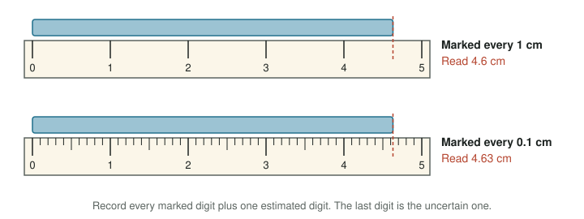

## 1. SI units (1.5)

Science uses the **metric system**, and specifically the seven **SI base units**. Chemistry uses five
of them most:

| Quantity | Unit | Symbol |
|---|---|---|
| mass | kilogram | kg |
| length | meter | m |
| time | second | s |
| temperature | kelvin | K |
| amount of substance | mole | mol |

Other units are built from these (**derived units**): volume in m³, density in kg/m³, energy in
joules (kg·m²/s²).

### Metric prefixes

A prefix multiplies the unit by a power of 10:

| Prefix | Symbol | Factor | Example |
|---|---|---|---|
| giga | G | $10^9$ | 1 Gm = $10^9$ m |
| mega | M | $10^6$ | 1 Mm = $10^6$ m |
| kilo | k | $10^3$ | 1 kg = 1000 g |
| deci | d | $10^{-1}$ | 1 dm = 0.1 m |
| centi | c | $10^{-2}$ | 1 cm = 0.01 m |
| milli | m | $10^{-3}$ | 1 mL = 0.001 L |
| micro | μ | $10^{-6}$ | 1 μm = $10^{-6}$ m |
| nano | n | $10^{-9}$ | 1 nm = $10^{-9}$ m |
| pico | p | $10^{-12}$ | 1 pm = $10^{-12}$ m |

One non-SI unit shows up often for atom sizes: the **ångström**, $1\ \text{Å} = 10^{-10}\ \text{m} = 100\ \text{pm}$.

### Volume

Volume is length cubed. The everyday chemistry unit is the **liter**:

$$
1\ \text{L} = 1\ \text{dm}^3 = 1000\ \text{cm}^3 \qquad 1\ \text{mL} = 1\ \text{cm}^3
$$

### Temperature

Temperature measures how hot or cold something is, which is the average kinetic energy of its particles.
Chemistry uses the Celsius and Kelvin scales:

$$
\text{K} = {}^\circ\text{C} + 273.15
$$

- The **Kelvin** scale starts at **absolute zero** (0 K = −273.15 °C), the lowest possible temperature.
  It has no negative values, and it's written "K," not "°K."
- A **change** of 1 K equals a change of 1 °C.

Gas laws and most later equations need kelvins.

### Density

$$
d = \frac{m}{V}
$$

Solids and liquids usually use g/cm³ or g/mL. Water is about 1.00 g/mL near room temperature. Density
is intensive, so it identifies a substance, and it lets you convert between mass and volume.

<Reveal label="Worked example: identify a metal by density">

A metal cube 2.50 cm on each side has a mass of 140.6 g. Is it aluminum (2.70 g/cm³), iron
(7.87 g/cm³), or copper (8.96 g/cm³)?

$V = (2.50\ \text{cm})^3 = 15.625\ \text{cm}^3$ (keep the extra digits for now)

$d = 140.6\ \text{g} / 15.625\ \text{cm}^3 = 9.00\ \text{g/cm}^3$ (3 sig figs, from 2.50)

The closest is **copper**. Rounding the volume to 15.6 cm³ first would give 9.01 g/cm³, which is why
you round only at the end (section 6).

</Reveal>

## 2. Exact and inexact numbers (1.6)

- **Exact numbers** come from counting (24 students) or from definitions (1 ft = 12 in, 1 kg = 1000 g,
  1 in = 2.54 cm). They have no uncertainty and never limit significant figures.
- **Inexact numbers** come from **measurements**. Every measurement has some uncertainty.

## 3. Precision and accuracy (1.6)

- **Precision** is how close repeated measurements are **to each other**.
- **Accuracy** is how close measurements are **to the true value**.

A balance that isn't zeroed can give very precise readings that are all wrong by the same amount. That's
a **systematic error**, and repeating the measurement doesn't fix it. **Random errors** scatter readings
on both sides of the true value; averaging more trials reduces their effect.

## 4. Reading an instrument

Record every digit the scale shows **plus one estimated digit**. All of those digits are **significant
figures**: the certain ones and the one uncertain one at the end.

A reading of 4.6 cm means "somewhere around 4.5 to 4.7 cm." A reading of 4.63 cm has one more
significant figure because the second ruler is finer. The number of significant figures shows how
precise the measurement was.

## 5. Counting significant figures (1.6)

| Rule | Example | Sig figs |
|---|---|---|
| Nonzero digits always count | 3.47 | 3 |
| Zeros **between** nonzero digits count | 1.005 | 4 |
| **Leading** zeros never count (they only place the decimal point) | 0.0062 | 2 |
| **Trailing** zeros count if there's a decimal point | 2.300, 40.0 | 4, 3 |
| Trailing zeros with **no** decimal point are ambiguous | 1500 | 2, 3, or 4 |

Scientific notation removes the ambiguity: $1.5 \times 10^3$ has 2 significant figures and
$1.500 \times 10^3$ has 4. A decimal point written after the zeros, "1500.", also means all 4 count.

<Callout type="warning">
Leading zeros don't count even when they're after the decimal point: 0.00450 has **3** significant figures
(4, 5, and the final zero). The trailing zero counts because the number has a decimal point.
</Callout>

## 6. Significant figures in calculations (1.6)

**Multiplying and dividing:** the answer has the **same number of significant figures** as the
measurement with the **fewest**.

$$
6.221\ \text{cm} \times 5.2\ \text{cm} = 32.3492 \to 32\ \text{cm}^2 \quad \text{(2 sig figs, from 5.2)}
$$

**Adding and subtracting:** the answer has the **same number of decimal places** as the measurement
with the **fewest decimal places**.

$$
20.42 + 1.322 + 83.1 = 104.842 \to 104.8 \quad \text{(1 decimal place, from 83.1)}
$$

Notice that 104.8 has 4 significant figures, more than 83.1 has. Addition counts decimal places, not
significant figures.

**Rounding:** if the first digit dropped is 5 or more, round up; otherwise, leave the last kept digit alone.

**Multi-step problems:** keep at least one extra digit through the intermediate steps and round only
the final answer. Rounding at every step can shift the last digit.

<Reveal label="Worked example: a mixed calculation">

Calculate $\dfrac{(12.53 - 11.2)}{0.0371}$ to the correct number of significant figures.

**Subtraction first:** $12.53 - 11.2 = 1.33$, which is good only to one decimal place (from 11.2):
1.3, with 2 significant figures.

**Division:** $1.33 / 0.0371 = 35.85$. The numerator has 2 sig figs and 0.0371 has 3, so the
answer has 2: **36**.

Keep 1.33 in the calculator and round only the final answer. Rounding the difference to 1.3 first
gives $1.3 / 0.0371 = 35.04$, or 35, which is off in the last digit.

</Reveal>

<Callout type="not-on-ap">
Significant figures aren't a CED topic. AP free-response scoring usually accepts answers within a
reasonable range of significant figures, but class tests may grade them, so follow the rules above.
</Callout>
