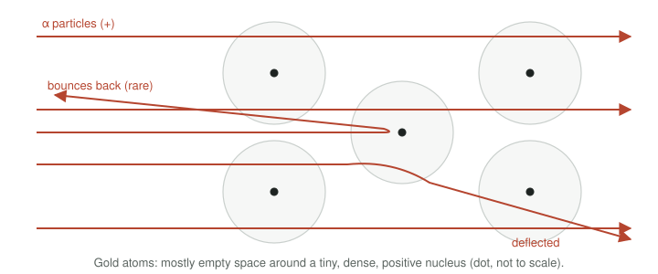

## 1. Dalton's atomic theory (2.1)

Around 1805, John Dalton explained the known laws of chemical combination with four ideas:

1. Each element is made of tiny particles called **atoms**.
2. All atoms of one element are identical; atoms of different elements are different and have
   different masses.
3. Atoms are not created or destroyed in chemical reactions, and one element's atoms can't turn into
   another's.
4. Compounds form when atoms of more than one element combine, in a **fixed whole-number ratio**.

Point 2 turned out to be wrong in one way: atoms of the same element can have different masses
(isotopes, section 4). The rest still holds for chemical reactions.

### The mass laws the theory explains

| Law | Statement | How atoms explain it |
|---|---|---|
| **Conservation of mass** | Total mass is the same before and after a reaction. | Atoms are only rearranged (point 3). |
| **Constant composition** (definite proportions) | A compound always has the same elements in the same proportions by mass. | Every molecule or formula unit has the same atoms (point 4). |
| **Multiple proportions** | When two elements form more than one compound, the masses of one element that combine with a fixed mass of the other are in a small whole-number ratio. | The compounds differ by whole atoms. |

<Reveal label="Worked example: the law of multiple proportions">

Carbon forms two oxides. In compound I, 1.000 g of carbon combines with 1.332 g of oxygen. In compound
II, 1.000 g of carbon combines with 2.664 g of oxygen. Show that this fits the law of multiple
proportions.

With carbon held at 1.000 g, the oxygen masses are in the ratio

$$
\frac{2.664\ \text{g}}{1.332\ \text{g}} = 2.000
$$

a small whole number. Compound II has twice as many O atoms per C atom as compound I. They are CO and
$\ce{CO2}$.

</Reveal>

## 2. Discovering the electron (2.2)

- **Cathode rays.** In a sealed tube with most of the air pumped out, a high voltage produces a beam
  from the negative electrode (the cathode). Electric and magnetic fields bend the beam toward the
  positive side, so it's made of **negative particles**, and every metal used as the cathode gives the
  same particles. These are **electrons**.
- **J. J. Thomson** (1897) measured how much the beam bent and found the electron's **charge-to-mass
  ratio**: $1.76 \times 10^8$ C/g.
- **Robert Millikan** (1909) watched charged oil drops fall between charged plates and found that every
  drop's charge was a whole-number multiple of $1.602 \times 10^{-19}$ C, the **charge of one
  electron**. With Thomson's ratio, that gives the electron's mass: $9.10 \times 10^{-28}$ g, about
  1/1836 of a hydrogen atom.

Since atoms are neutral but contain electrons, they also have to contain positive charge. Thomson
pictured the atom as a sphere of positive charge with electrons embedded in it (the "plum-pudding"
model).

## 3. Radioactivity and the nucleus (2.2)

**Radioactivity** is the spontaneous emission of radiation by unstable atoms. Ernest Rutherford sorted
it into three kinds:

| Radiation | Charge | What it is |
|---|---|---|
| alpha (α) | +2 | a helium nucleus: 2 protons + 2 neutrons, fairly heavy |
| beta (β) | −1 | a fast electron |
| gamma (γ) | 0 | high-energy light; no mass |

### The gold-foil experiment

Rutherford's group (Geiger and Marsden, 1909–1911) fired alpha particles at gold foil a few hundred
atoms thick. Under the plum-pudding model, the spread-out positive charge should only nudge them.

| Observation | Conclusion |
|---|---|
| Almost all alpha particles went straight through. | The atom is **mostly empty space**. |
| A few were deflected at large angles, and roughly 1 in 8000 bounced back. | The positive charge and nearly all the mass are packed into a tiny, dense **nucleus**. Only a direct approach to that concentrated charge can turn back an alpha particle. |

This is the **nuclear model** of the atom. If an atom were the size of a football stadium, its
nucleus would be about the size of a marble. Later, the **proton** (positive) and **neutron**
(neutral) were found inside the nucleus.

## 4. The modern view of the atom (2.3)

| Particle | Charge (units of $1.602 \times 10^{-19}$ C) | Mass (amu) | Where |
|---|---|---|---|
| proton | +1 | 1.0073 | nucleus |
| neutron | 0 | 1.0087 | nucleus |
| electron | −1 | 0.000549 (about 1/1836) | around the nucleus |

Atoms are about 1–5 Å across ($1\ \text{Å} = 10^{-10}$ m), while nuclei are about $10^{-4}$ Å. Nearly
all of an atom's mass is in its nucleus, but nearly all its volume is the space where the electrons
are. The electrons decide how an atom behaves chemically.

### Atomic number, mass number, and isotopes

- **Atomic number** ($Z$): the number of **protons**. It defines the element: every carbon atom has 6.
- **Mass number** ($A$): protons + neutrons. Neutrons $= A - Z$.
- **Isotopes**: atoms of the same element (same $Z$) with **different numbers of neutrons** (different $A$).

An atom's symbol puts the mass number top left and the atomic number bottom left:

$$
{}^{A}_{Z}\text{X} \qquad \text{e.g.}\quad {}^{12}_{6}\text{C},\ {}^{13}_{6}\text{C},\ {}^{14}_{6}\text{C}
$$

The atomic number is often left off since the symbol already gives it: $^{14}\text{C}$, or "carbon-14."
Isotopes of an element have nearly identical chemistry, because they have the same number of protons
and electrons.

### Counting particles in atoms and ions

For a neutral atom, electrons = protons. An ion has gained or lost electrons, never protons:

$$
\text{electrons} = Z - \text{charge}
$$

| Symbol | Protons | Neutrons | Electrons |
|---|---|---|---|
| ${}^{27}_{13}\text{Al}$ | 13 | 14 | 13 |
| ${}^{27}_{13}\text{Al}^{3+}$ | 13 | 14 | 10 |
| ${}^{80}_{34}\text{Se}^{2-}$ | 34 | 46 | 36 |
| ${}^{37}\text{Cl}^{-}$ | 17 | 20 | 18 |

<Reveal label="Worked example: identify the species">

A species has 26 protons, 30 neutrons, and 23 electrons. Write its symbol.

26 protons makes it iron (Fe). Mass number $= 26 + 30 = 56$. Charge $= 26 - 23 = +3$.

The symbol is ${}^{56}_{26}\text{Fe}^{3+}$.

</Reveal>

<Callout type="warning">
The mass number $A$ is a count of particles, always a whole number. The **atomic weight** on the
periodic table (55.85 for Fe) is an average mass that isn't a whole number. The next lesson explains
the difference.
</Callout>

<Callout type="ap-tip">
AP topic 1.5 starts here: the atom has a positive nucleus of protons and neutrons with negative
electrons around it, and the attraction between them follows Coulomb's law. Chapter 6 adds how the
electrons are arranged.
</Callout>
