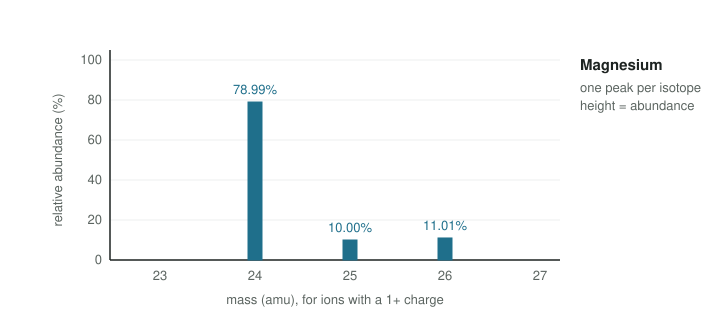

## 1. The atomic mass unit (2.4)

Atoms are far too light to weigh in grams conveniently, so their masses are given in **atomic mass
units** (amu, also written u or Da). The scale is set by one isotope:

$$
1\ \text{amu} = \tfrac{1}{12} \text{ the mass of one } {}^{12}\text{C} \text{ atom} = 1.66054 \times 10^{-24}\ \text{g}
$$

So a $^{12}\text{C}$ atom is exactly 12 amu. A proton and a neutron are each about 1 amu, which is why
an isotope's mass in amu is close to its mass number, though not exactly equal (a $^{35}\text{Cl}$
atom is 34.969 amu).

## 2. Atomic weight is a weighted average (2.4)

Most elements occur naturally as a mix of isotopes. The **atomic weight** (or **average atomic mass**)
on the periodic table is the average mass of an atom in that natural mix, with each isotope counted by
its abundance:

$$
\text{atomic weight} = \sum (\text{isotope mass}) \times (\text{fractional abundance})
$$

<Reveal label="Worked example: atomic weight of chlorine">

Natural chlorine is 75.78% $^{35}\text{Cl}$ (34.969 amu) and 24.22% $^{37}\text{Cl}$ (36.966 amu).

Convert percents to fractions and weight each mass:

$$
(0.7578)(34.969) + (0.2422)(36.966) = 26.50 + 8.953 = 35.45\ \text{amu}
$$

That matches the periodic table. No single chlorine atom has a mass of 35.45 amu; it's the average.

</Reveal>

The atomic weight is always **closer to the more abundant isotope**. Chlorine's 35.45 is much closer
to 35 than to 37, so $^{35}\text{Cl}$ is the main isotope. Bromine's 79.90 is almost exactly halfway
between 79 and 81, so its two isotopes are nearly equal in abundance.

<Callout type="warning">
A plain average of the isotope masses ignores abundance. For chlorine it gives $(34.969 + 36.966)/2 =
35.97$ amu, which is wrong. Weight each mass by how common it is.
</Callout>

## 3. Mass spectrometry (2.4)

A **mass spectrometer** measures the masses of atoms and how many of each there are:

1. The sample is vaporized and its atoms are **ionized**, usually by knocking off one electron to make
   1+ ions.
2. The ions are **accelerated** by an electric field.
3. A **magnetic field** bends their paths. **Lighter ions bend more**; heavier ones bend less.
4. A **detector** counts the ions arriving at each mass.

The result is a **mass spectrum**: a graph of how many ions were detected (relative abundance) at each
mass. For one element, each peak is one isotope.

Reading a single-element spectrum:

- The **number of peaks** is the number of isotopes.
- A peak's **position** is that isotope's mass (for a 1+ ion, its mass-to-charge ratio equals its mass).
- A peak's **height** is that isotope's relative abundance.

<Reveal label="Worked example: atomic weight from the magnesium spectrum">

The isotope masses are 23.985, 24.986, and 25.983 amu. Using the abundances on the spectrum:

$$
(0.7899)(23.985) + (0.1000)(24.986) + (0.1101)(25.983) = 18.95 + 2.499 + 2.861 = 24.31\ \text{amu}
$$

Using the peak positions as whole numbers (24, 25, 26) gives 24.32, close enough to identify magnesium
(24.30 on the AP periodic table).

</Reveal>

### When the peaks aren't in percent

Some spectra scale the tallest peak to 100 instead of giving percents. Divide each height by the **total**
of all the heights to get fractions.

<Reveal label="Worked example: boron from relative heights">

A spectrum of boron has a peak at 10.013 amu with height 24.8 and a peak at 11.009 amu with height 100.

Total height $= 24.8 + 100 = 124.8$.

- $^{10}\text{B}$: $24.8 / 124.8 = 0.199$ (19.9%)
- $^{11}\text{B}$: $100 / 124.8 = 0.801$ (80.1%)

$$
(0.199)(10.013) + (0.801)(11.009) = 1.99 + 8.82 = 10.81\ \text{amu}
$$

</Reveal>

## 4. Finding abundances from the atomic weight

With **two** isotopes, call one fraction $x$. The other is $1 - x$, since the fractions add to 1.

<Reveal label="Worked example: copper">

Copper (atomic weight 63.55 amu) has two isotopes: $^{63}\text{Cu}$ at 62.930 amu and $^{65}\text{Cu}$
at 64.928 amu. Find the percent of each.

$$
62.930x + 64.928(1 - x) = 63.55
$$

$$
64.928 - 1.998x = 63.55 \quad\Rightarrow\quad x = \frac{1.378}{1.998} = 0.690
$$

Copper is **69.0%** $^{63}\text{Cu}$ and **31.0%** $^{65}\text{Cu}$. As a check, 63.55 is closer to
63 than to 65, so $^{63}\text{Cu}$ should be the larger share, as it is.

</Reveal>

<Callout type="ap-tip">
AP topic 1.2 asks for exactly these skills: identifying isotopes and their abundances from a spectrum,
and estimating or calculating the average atomic mass. A quick estimate is often enough for a
multiple-choice question: decide which isotope the average is closest to.
</Callout>
