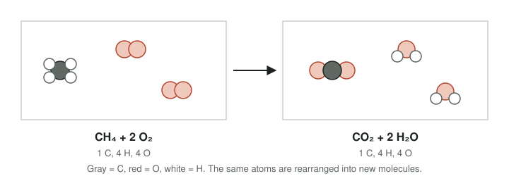

## 1. What an equation says (3.1)

A **chemical equation** shows a reaction with formulas. **Reactants** are on the left, **products** on
the right:

$$
\ce{2H2(g) + O2(g) -> 2H2O(l)}
$$

The numbers in front are **coefficients**. They give the relative numbers of molecules (or moles):
two $\ce{H2}$ molecules react with one $\ce{O2}$ molecule to make two $\ce{H2O}$ molecules. A
coefficient of 1 isn't written.

Atoms are neither created nor destroyed in a reaction (the **law of conservation of mass**), so a
correct equation has the **same number of each kind of atom** on both sides. Then it's **balanced**.

### Coefficients versus subscripts

| Change | Effect |
|---|---|
| Coefficient: $\ce{H2O}$ → $\ce{2H2O}$ | twice as many water molecules |
| Subscript: $\ce{H2O}$ → $\ce{H2O2}$ | a **different substance** (hydrogen peroxide) |

<Callout type="warning">
Balance an equation only by changing **coefficients**. Changing a subscript changes the identity of the
substance, so the equation would describe a different reaction.
</Callout>

### States

Physical states go in parentheses after each formula: **(g)** gas, **(l)** liquid, **(s)** solid, and
**(aq)** dissolved in water (aqueous). Sometimes a triangle (Δ) above the arrow means the reactants are
heated.

## 2. Balancing step by step (3.1)

1. Write the correct formulas of all reactants and products.
2. Start with an element that appears in only **one** reactant and **one** product, preferably in the
   most complicated formula.
3. Leave elements that appear by themselves (like $\ce{O2}$ or Fe) for last, since changing their
   coefficient changes nothing else.
4. Keep polyatomic ions that appear unchanged on both sides together as a unit.
5. Make sure the coefficients are the **smallest whole numbers**, then count every atom again.

<Reveal label="Worked example: balance the combustion of propane">

$$
\ce{C3H8 + O2 -> CO2 + H2O}
$$

**C:** 3 on the left, so put 3 in front of $\ce{CO2}$.

**H:** 8 on the left, so put 4 in front of $\ce{H2O}$ (4 × 2 = 8).

**O:** the right now has $3(2) + 4(1) = 10$ O atoms, so the left needs 5 $\ce{O2}$.

$$
\ce{C3H8 + 5O2 -> 3CO2 + 4H2O}
$$

Check: C 3 = 3, H 8 = 8, O 10 = 10.

</Reveal>

<Reveal label="Worked example: when you get a fraction">

$$
\ce{C2H6 + O2 -> CO2 + H2O}
$$

C gives $\ce{2CO2}$; H gives $\ce{3H2O}$. Then O on the right $= 2(2) + 3 = 7$, so you'd need
$\tfrac{7}{2}\ \ce{O2}$. Multiply **everything** by 2 to clear the fraction:

$$
\ce{2C2H6 + 7O2 -> 4CO2 + 6H2O}
$$

</Reveal>

<Reveal label="Worked example: keep polyatomic ions together">

$$
\ce{Ca(OH)2 + H3PO4 -> Ca3(PO4)2 + H2O}
$$

Treat $\ce{PO4}$ as one unit: 2 on the right, so $\ce{2H3PO4}$. Ca: 3 on the right, so $\ce{3Ca(OH)2}$.

Now count H on the left: $3(2) + 2(3) = 12$ H, which makes $\ce{6H2O}$. Check O outside the phosphate:
$3(2) = 6$ O in hydroxides, and 6 in the waters.

$$
\ce{3Ca(OH)2 + 2H3PO4 -> Ca3(PO4)2 + 6H2O}
$$

</Reveal>

## 3. Evidence of a reaction

A **chemical change** makes new substances. Signs that one has happened:

- heat or light is given off (or absorbed),
- a gas forms,
- a **precipitate** (an insoluble solid) appears when solutions are mixed, or
- the color changes.

None of these proves a reaction by itself. Boiling water makes a gas without any reaction. The real
test is whether bonds broke and new substances formed.

## 4. Particle diagrams of reactions

The AP exam asks you to connect an equation to a picture of the particles. In a correct diagram,
**every atom on the left appears on the right**, arranged into new molecules.

When the reactants in a diagram aren't in the exact ratio of the equation, some of one reactant is
left over. That's the idea of a **limiting reactant**, covered at the end of this chapter.

<Reveal label="Worked example: write the equation from a diagram">

A box contains 6 $\ce{NO}$ molecules and 3 $\ce{O2}$ molecules. After the reaction it contains 6
$\ce{NO2}$ molecules and nothing else. Write the balanced equation.

The ratio NO : $\ce{O2}$ : $\ce{NO2}$ is 6 : 3 : 6, which reduces to 2 : 1 : 2:

$$
\ce{2NO + O2 -> 2NO2}
$$

Check: 2 N and 4 O on each side.

</Reveal>

## 5. Three simple reaction patterns (3.2)

| Type | Pattern | Example |
|---|---|---|
| **Combination** (synthesis) | A + B → C | $\ce{2Mg(s) + O2(g) -> 2MgO(s)}$ |
| | | $\ce{N2(g) + 3H2(g) -> 2NH3(g)}$ |
| | | $\ce{CaO(s) + H2O(l) -> Ca(OH)2(s)}$ |
| **Decomposition** | C → A + B | $\ce{CaCO3(s) -> CaO(s) + CO2(g)}$ |
| | | $\ce{2KClO3(s) -> 2KCl(s) + 3O2(g)}$ |
| | | $\ce{2NaN3(s) -> 2Na(s) + 3N2(g)}$ |
| **Combustion** | fuel + $\ce{O2}$ → oxides | $\ce{CH4(g) + 2O2(g) -> CO2(g) + 2H2O(l)}$ |

- In a **combination** reaction, two or more reactants form **one** product. A metal and a nonmetal
  combine to form an ionic solid; the ion charges give the product's formula (Mg and $\ce{O2}$ give
  MgO, since the ions are $\ce{Mg^2+}$ and $\ce{O^2-}$).
- In a **decomposition** reaction, one substance breaks into two or more, usually when heated. Metal
  carbonates give a metal oxide and $\ce{CO2}$. The decomposition of sodium azide fills car air bags.
- A **combustion** reaction is a rapid reaction with oxygen that gives off heat and usually a flame.

### Combustion of hydrocarbons

When a hydrocarbon (C and H only) or a compound of C, H, and O burns **completely** in air, the products
are always $\ce{CO2}$ and $\ce{H2O}$:

$$
\ce{C6H12O6(s) + 6O2(g) -> 6CO2(g) + 6H2O(l)}
$$

The same equation describes glucose being "burned" in your cells, although there it happens in many
slow steps. With too little oxygen, combustion is **incomplete** and also makes CO or soot (C).

<Callout type="ap-tip">
AP topic 4.7 sorts reactions as acid–base, precipitation, or oxidation–reduction (redox), all covered in
Chapter 4. **Combustion is a kind of redox reaction**: carbon in the fuel loses electrons to oxygen.
Many combination and decomposition reactions are redox reactions too, like Mg burning to MgO.
</Callout>

<Reveal label="Worked example: predict and balance">

Write balanced equations for (a) the combination of aluminum and chlorine gas, (b) the decomposition of
solid barium carbonate when heated, and (c) the complete combustion of liquid ethanol, $\ce{C2H5OH}$.

**(a)** The ions are $\ce{Al^3+}$ and $\ce{Cl-}$, so the product is $\ce{AlCl3}$:

$$
\ce{2Al(s) + 3Cl2(g) -> 2AlCl3(s)}
$$

**(b)** A carbonate gives the oxide and $\ce{CO2}$:

$$
\ce{BaCO3(s) -> BaO(s) + CO2(g)}
$$

**(c)** C: $\ce{2CO2}$. H: 6 H, so $\ce{3H2O}$. O on the right $= 4 + 3 = 7$; ethanol supplies 1, so
$\ce{O2}$ supplies 6, which is $\ce{3O2}$:

$$
\ce{C2H5OH(l) + 3O2(g) -> 2CO2(g) + 3H2O(l)}
$$

</Reveal>
