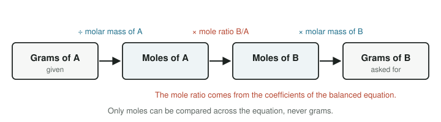
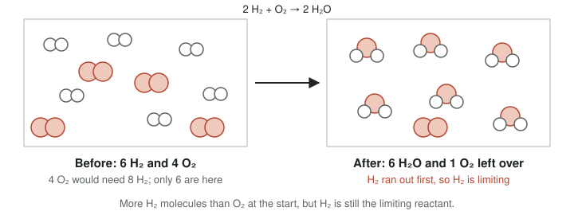

## 1. Mole ratios (3.6)

The coefficients of a balanced equation give the ratio of **moles** (or molecules) that react and form:

$$
\ce{N2(g) + 3H2(g) -> 2NH3(g)}
$$

1 mol $\ce{N2}$ reacts with 3 mol $\ce{H2}$ to make 2 mol $\ce{NH3}$. Any pair gives a conversion
factor, such as

$$
\frac{2\ \text{mol NH}_3}{1\ \text{mol N}_2} \qquad \frac{3\ \text{mol H}_2}{2\ \text{mol NH}_3}
$$

Coefficients are **not** mass ratios. 1 g of $\ce{N2}$ does not react with 3 g of $\ce{H2}$; the masses
depend on the molar masses too.

## 2. Gram-to-gram calculations (3.6)

Grams can't be compared across an equation directly, so every problem passes through moles:

<Reveal label="Worked example: oxygen needed to burn propane">

$$
\ce{C3H8(g) + 5O2(g) -> 3CO2(g) + 4H2O(l)}
$$

What mass of $\ce{O2}$ is needed to burn 10.0 g of propane, and what mass of $\ce{CO2}$ forms?

$\mathcal{M}(\ce{C3H8}) = 3(12.01) + 8(1.008) = 44.09$ g/mol

$$
10.0\ \text{g C}_3\text{H}_8 \times \frac{1\ \text{mol C}_3\text{H}_8}{44.09\ \text{g}} \times \frac{5\ \text{mol O}_2}{1\ \text{mol C}_3\text{H}_8} \times \frac{32.00\ \text{g}}{1\ \text{mol O}_2} = 36.3\ \text{g O}_2
$$

$$
10.0\ \text{g C}_3\text{H}_8 \times \frac{1\ \text{mol}}{44.09\ \text{g}} \times \frac{3\ \text{mol CO}_2}{1\ \text{mol C}_3\text{H}_8} \times \frac{44.01\ \text{g}}{1\ \text{mol CO}_2} = 29.9\ \text{g CO}_2
$$

The burned propane uses more than three times its own mass in oxygen.

</Reveal>

<Callout type="warning">
The most common error is skipping the mole ratio (or using it upside down). Write the units with
the formula, "mol $\ce{O2}$ / mol $\ce{C3H8}$," so the wrong setup won't cancel.
</Callout>

## 3. Limiting reactants (3.7)

Reactants are rarely mixed in exactly the ratio of the equation. The reactant that **runs out first**
is the **limiting reactant**: it stops the reaction and decides how much product forms. The other is the
**excess reactant**, and some of it is left over.

<Callout type="warning">
The limiting reactant isn't necessarily the one with the fewest grams or even the fewest moles. In the
diagram there are more $\ce{H2}$ molecules than $\ce{O2}$, but each $\ce{O2}$ needs **two** $\ce{H2}$,
so $\ce{H2}$ runs out first. Always account for the coefficients.
</Callout>

### Finding the limiting reactant

The most reliable method: **calculate the product each reactant could make.** The one that makes
**less** product is limiting, and that smaller amount is the answer.

<Reveal label="Worked example: aluminum and chlorine">

$$
\ce{2Al(s) + 3Cl2(g) -> 2AlCl3(s)}
$$

25.0 g of Al reacts with 45.0 g of $\ce{Cl2}$. Find the limiting reactant, the mass of $\ce{AlCl3}$
formed, and the mass of excess reactant left.

**Moles of each reactant:**

- Al: $25.0 / 26.98 = 0.9266$ mol
- $\ce{Cl2}$: $45.0 / 70.90 = 0.6347$ mol

**Moles of $\ce{AlCl3}$ each could make:**

- from Al: $0.9266 \times \tfrac{2}{2} = 0.9266$ mol
- from $\ce{Cl2}$: $0.6347 \times \tfrac{2}{3} = 0.4231$ mol

$\ce{Cl2}$ makes less, so **$\ce{Cl2}$ is limiting**.

**Product:** $0.4231\ \text{mol} \times 133.33\ \text{g/mol} = 56.4$ g $\ce{AlCl3}$.

**Excess Al:** Al used $= 0.4231\ \text{mol AlCl}_3 \times \tfrac{2\ \text{mol Al}}{2\ \text{mol AlCl}_3} = 0.4231$ mol $= 11.4$ g.
Al left $= 25.0 - 11.4 = 13.6$ g.

**Check:** mass is conserved: $25.0 + 45.0 = 70.0$ g before, and $56.4 + 13.6 = 70.0$ g after.

</Reveal>

A second method compares the mole ratio you **have** with the ratio the equation **needs**. Here
$\ce{Cl2}$/Al needed $= 3/2 = 1.5$, but the ratio present is $0.6347/0.9266 = 0.685$. There's less
$\ce{Cl2}$ per Al than needed, so $\ce{Cl2}$ runs out first.

### Changing the amounts

AP topic 4.5 asks how changing a reactant changes the product:

- Adding more of the **limiting** reactant makes more product (until it's no longer limiting).
- Adding more of the **excess** reactant makes **no more** product. It only leaves more left over.

## 4. Theoretical, actual, and percent yield (3.7)

- **Theoretical yield**: the amount of product calculated from the limiting reactant, the most the
  reaction could give.
- **Actual yield**: the amount really obtained in the lab.

$$
\text{percent yield} = \frac{\text{actual yield}}{\text{theoretical yield}} \times 100\%
$$

<Reveal label="Worked example: percent yield">

In the aluminum chloride reaction above, a student collects 48.2 g of $\ce{AlCl3}$. What is the percent yield?

$$
\frac{48.2\ \text{g}}{56.42\ \text{g}} \times 100\% = 85.4\%
$$

</Reveal>

Actual yields are usually **less** than theoretical because:

- the reaction doesn't go to completion, or reaches equilibrium (Chapter 15),
- **side reactions** use up reactant to make other products, or
- some product is lost when it's filtered, transferred, or purified.

A percent yield **over 100%** means an error. The usual cause is product that's still **wet** or
contaminated, so it weighs more than the pure product would.

<Reveal label="Worked example: work backward from a percent yield">

Iron is made from iron(III) oxide: $\ce{Fe2O3(s) + 3CO(g) -> 2Fe(s) + 3CO2(g)}$. The process has an 82.0%
yield. What mass of $\ce{Fe2O3}$ is needed to produce 1.00 kg of iron?

Theoretical yield needed $= 1000\ \text{g} / 0.820 = 1220$ g Fe.

$$
1220\ \text{g Fe} \times \frac{1\ \text{mol Fe}}{55.85\ \text{g}} \times \frac{1\ \text{mol Fe}_2\text{O}_3}{2\ \text{mol Fe}} \times \frac{159.70\ \text{g}}{1\ \text{mol Fe}_2\text{O}_3} = 1744\ \text{g} \approx 1.74\ \text{kg}
$$

</Reveal>

<Callout type="ap-tip">
On an AP free-response question, show the mole ratio as a separate, labeled step, and identify the
limiting reactant **by name** with the calculation that shows it. A correct number with no
justification for which reactant is limiting usually loses that point. Chapters 4 and 10 extend the same
method to solutions (moles from molarity) and gases (moles from $PV = nRT$).
</Callout>
