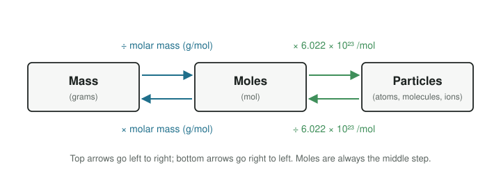

## 1. Formula weight (3.3)

The **formula weight** (FW) of a substance is the sum of the atomic weights of the atoms in its formula,
in amu:

$$
\ce{H2SO4}: \quad 2(1.008) + 32.06 + 4(16.00) = 98.08\ \text{amu}
$$

For a molecular substance, the formula weight is also called the **molecular weight** (MW). Ionic
compounds don't have molecules, so their sum is just the formula weight of one formula unit.

<Reveal label="Worked example: formula weight with parentheses">

Find the formula weight of calcium nitrate, $\ce{Ca(NO3)2}$.

The subscript 2 doubles everything in the parentheses: 1 Ca, 2 N, 6 O.

$$
40.08 + 2(14.01) + 6(16.00) = 40.08 + 28.02 + 96.00 = 164.10\ \text{amu}
$$

</Reveal>

The atomic weights here come from the periodic table given with AP tests and class tests
(H 1.008, C 12.01, N 14.01, O 16.00, and so on). Use the values from the table you're given.

## 2. Percent composition (3.3)

The **percent composition** gives the percent of a compound's mass that comes from each element:

$$
\%\,\text{element} = \frac{(\text{number of atoms of that element})(\text{atomic weight})}{\text{formula weight of the compound}} \times 100\%
$$

<Reveal label="Worked example: percent composition of glucose">

Glucose is $\ce{C6H12O6}$. Formula weight $= 6(12.01) + 12(1.008) + 6(16.00) = 72.06 + 12.096 + 96.00 = 180.16$ amu.

- %C $= 72.06 / 180.16 \times 100\% = 40.00\%$
- %H $= 12.096 / 180.16 \times 100\% = 6.71\%$
- %O $= 96.00 / 180.16 \times 100\% = 53.29\%$

The percents add up to 100%. Because of the law of constant composition, every sample of pure glucose
has this composition.

</Reveal>

Two compounds with the same **empirical formula** have the same percent composition. Glucose
($\ce{C6H12O6}$) and formaldehyde ($\ce{CH2O}$) are both 40.00% C, so percent composition alone can't
tell them apart. The next lesson reverses this calculation to find a formula from percents.

## 3. The mole (3.4)

Atoms are too small to count one by one, so chemists count them by the **mole** (mol), the same way
eggs are counted by the dozen. One mole is

$$
N_A = 6.022 \times 10^{23}\ \text{particles}
$$

**Avogadro's number**. A mole of anything has that many: a mole of C atoms, a mole of $\ce{H2O}$
molecules, a mole of NaCl formula units, or a mole of $\ce{Na+}$ ions.

The number is chosen so that the mass scales match:

| | One particle | One mole |
|---|---|---|
| $^{12}$C atom | 12 amu (exactly) | 12 g |
| C atom (natural mix) | 12.01 amu (average) | 12.01 g |
| $\ce{H2O}$ molecule | 18.02 amu | 18.02 g |
| NaCl formula unit | 58.44 amu | 58.44 g |

**The mass of one mole in grams has the same number as the mass of one particle in amu.** That
number is the **molar mass** ($\mathcal{M}$), in **g/mol**: water's molar mass is 18.02 g/mol.

<Callout type="warning">
Say which particle you mean. One mole of $\ce{O2}$ is 32.00 g and contains $6.022 \times 10^{23}$
molecules, but $2 \times 6.022 \times 10^{23}$ oxygen **atoms**. One mole of $\ce{CaCl2}$ contains
one mole of $\ce{Ca^2+}$ and two moles of $\ce{Cl-}$.
</Callout>

## 4. Converting between grams, moles, and particles (3.4)

Moles are the hub. Molar mass connects moles to grams, and Avogadro's number connects moles to
particles:

$$
n = \frac{m}{\mathcal{M}} \qquad N = n \times N_A
$$

There is **no direct step from grams to particles**: always go through moles.

<Reveal label="Worked example: grams to moles to molecules">

How many molecules are in 25.0 g of carbon dioxide? How many oxygen atoms?

$\mathcal{M}(\ce{CO2}) = 12.01 + 2(16.00) = 44.01$ g/mol

$$
25.0\ \text{g} \times \frac{1\ \text{mol}}{44.01\ \text{g}} = 0.568\ \text{mol}\ \ce{CO2}
$$

$$
0.568\ \text{mol} \times \frac{6.022 \times 10^{23}\ \text{molecules}}{1\ \text{mol}} = 3.42 \times 10^{23}\ \text{molecules}
$$

Each molecule has 2 O atoms: $2 \times 3.42 \times 10^{23} = 6.84 \times 10^{23}$ O atoms.

</Reveal>

<Reveal label="Worked example: moles to grams">

What is the mass of 0.0750 mol of aluminum sulfate, $\ce{Al2(SO4)3}$?

$\mathcal{M} = 2(26.98) + 3(32.06) + 12(16.00) = 53.96 + 96.18 + 192.00 = 342.14$ g/mol

$$
0.0750\ \text{mol} \times \frac{342.14\ \text{g}}{1\ \text{mol}} = 25.7\ \text{g}
$$

</Reveal>

<Reveal label="Worked example: the mass of one atom">

What is the mass, in grams, of a single gold atom (196.97 g/mol)?

$$
\frac{196.97\ \text{g}}{1\ \text{mol}} \times \frac{1\ \text{mol}}{6.022 \times 10^{23}\ \text{atoms}} = 3.271 \times 10^{-22}\ \text{g per atom}
$$

</Reveal>

### Sanity checks

- A few grams of a typical substance is a small fraction of a mole (0.01 to 1 mol).
- Numbers of particles in anything you can weigh are huge, around $10^{20}$ to $10^{24}$.
- For the **same mass**, the substance with the **smaller molar mass** has **more moles** and more
  particles. 10 g of $\ce{H2}$ (2.016 g/mol) is about 5 mol; 10 g of $\ce{O2}$ (32.00 g/mol) is about
  0.31 mol.

<Callout type="ap-tip">
AP topic 1.1 wants the reasoning, not just the arithmetic: Avogadro's number connects a mass you can
measure in the lab to the number of particles reacting. A common multiple-choice question gives equal
masses of several substances and asks which has the most atoms or molecules. Compare moles (mass ÷
molar mass), then multiply by atoms per formula if the question asks about atoms.
</Callout>

<Reveal label="Worked example: which has the most atoms?">

Which sample contains the most atoms: 10.0 g of He, 10.0 g of $\ce{CH4}$, or 10.0 g of $\ce{NH3}$?

| Sample | Moles of substance | Atoms per formula | Moles of atoms |
|---|---|---|---|
| He (4.00 g/mol) | 2.50 | 1 | 2.50 |
| $\ce{CH4}$ (16.04 g/mol) | 0.623 | 5 | 3.12 |
| $\ce{NH3}$ (17.03 g/mol) | 0.587 | 4 | 2.35 |

$\ce{CH4}$ has the most atoms, even though He has the most particles.

</Reveal>
