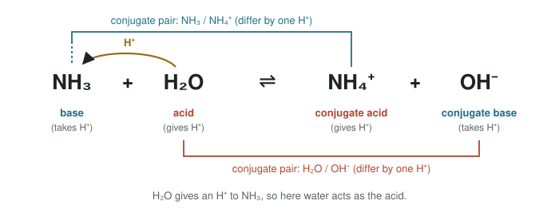
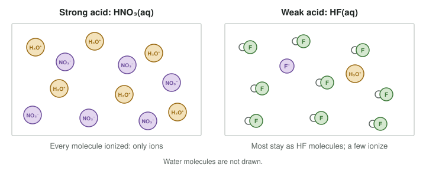

## 1. Acids and bases (4.3)

The first definitions, from Arrhenius: an **acid** makes $\ce{H+}$ ions in water, and a **base** makes
$\ce{OH-}$ ions.

The AP exam uses the broader **Brønsted–Lowry** definitions, which describe what happens between two
particles:

- an **acid** is a **proton ($\ce{H+}$) donor**,
- a **base** is a **proton acceptor**.

A bare $\ce{H+}$ is just a proton, and in water it immediately attaches to a water molecule, making the
**hydronium ion**, $\ce{H3O+}$. $\ce{H+(aq)}$ and $\ce{H3O+(aq)}$ mean the same thing in an equation.

$$
\ce{HCl(aq) + H2O(l) -> H3O+(aq) + Cl-(aq)}
$$

Here HCl is the acid (it gives up $\ce{H+}$) and water is the base (it takes the $\ce{H+}$).

An acid that can give up one $\ce{H+}$ per molecule is **monoprotic** (HCl, $\ce{HNO3}$). One that can
give up two is **diprotic** ($\ce{H2SO4}$).

## 2. Conjugate acid–base pairs (4.8)

Ammonia is a base even though it has no $\ce{OH-}$ to release. It takes an $\ce{H+}$ from water, which
leaves $\ce{OH-}$ behind:

After the transfer, the products can react the same way in reverse: $\ce{NH4+}$ can give the $\ce{H+}$
back, and $\ce{OH-}$ can take it. So every acid–base reaction has two **conjugate pairs**, and the two
members of a pair differ by exactly one $\ce{H+}$:

- acid → its **conjugate base** (one fewer H, one more negative charge): $\ce{H2O -> OH-}$, $\ce{HF -> F-}$
- base → its **conjugate acid** (one more H, one more positive charge): $\ce{NH3 -> NH4+}$, $\ce{H2O -> H3O+}$

Water acted as a base with HCl and as an acid with $\ce{NH3}$. A substance that can do both is
**amphiprotic**.

<Reveal label="Worked example: identify the pairs">

Label the acid, base, conjugate acid, and conjugate base:

$$
\ce{HCO3^-(aq) + HF(aq) <=> H2CO3(aq) + F-(aq)}
$$

HF loses an H and becomes $\ce{F-}$, so **HF is the acid** and **$\ce{F-}$ its conjugate base**.
$\ce{HCO3-}$ gains an H and becomes $\ce{H2CO3}$, so **$\ce{HCO3-}$ is the base** and **$\ce{H2CO3}$ its
conjugate acid**.

A common mistake is pairing HF with $\ce{H2CO3}$ because both are acids. A pair must differ by one $\ce{H+}$
and nothing else.

</Reveal>

## 3. Strong and weak acids and bases (4.3)

A **strong acid** ionizes completely in water. A **weak acid** ionizes only partly: most of it stays as
molecules.

The list to know:

| Strong acids | Strong bases |
|---|---|
| HCl, HBr, HI | Group 1 hydroxides: LiOH, NaOH, KOH, RbOH, CsOH |
| $\ce{HNO3}$, $\ce{HClO3}$, $\ce{HClO4}$ | The heavier group 2 hydroxides: $\ce{Ca(OH)2}$, $\ce{Sr(OH)2}$, $\ce{Ba(OH)2}$ |
| $\ce{H2SO4}$ (its first $\ce{H+}$) | |

The class list includes chloric acid, $\ce{HClO3}$, but the AP exam's list of strong acids leaves it out.

Assume any other acid is weak. HF, acetic acid ($\ce{HC2H3O2}$, also written $\ce{CH3COOH}$), nitrous
acid ($\ce{HNO2}$), and carbonic acid ($\ce{H2CO3}$) are common weak acids. Ammonia is the common weak
base.

<Callout type="warning">
HF looks like it belongs with HCl, HBr, and HI, but it's a **weak** acid. In an equation, write HF as a
molecule, not as $\ce{H+ + F-}$.
</Callout>

## 4. Neutralization (4.3)

An acid and a hydroxide base react to form water and a **salt**, an ionic compound made of the base's
cation and the acid's anion:

$$
\ce{HCl(aq) + NaOH(aq) -> H2O(l) + NaCl(aq)}
$$

The net ionic equation depends on whether the acid and base are strong or weak:

**Strong acid + strong base.** Both split into ions, and $\ce{Na+}$ and $\ce{Cl-}$ are spectators:

$$
\ce{H+(aq) + OH-(aq) -> H2O(l)}
$$

Every strong acid–strong base neutralization has this same net ionic equation.

**Weak acid + strong base.** The weak acid stays as a molecule:

$$
\ce{HC2H3O2(aq) + OH-(aq) -> C2H3O2^-(aq) + H2O(l)}
$$

**Strong acid + weak base.** Ammonia stays as a molecule, and the product is ammonium:

$$
\ce{H+(aq) + NH3(aq) -> NH4+(aq)}
$$

**Acid + insoluble base.** A solid hydroxide is written as a solid. Milk of magnesia neutralizing stomach
acid:

$$
\ce{Mg(OH)2(s) + 2H+(aq) -> Mg^2+(aq) + 2H2O(l)}
$$

<Reveal label="Worked example: nitrous acid and potassium hydroxide">

Write the molecular, complete ionic, and net ionic equations for the reaction of nitrous acid with
potassium hydroxide solution.

**Molecular:**

$$
\ce{HNO2(aq) + KOH(aq) -> KNO2(aq) + H2O(l)}
$$

**Complete ionic:** $\ce{HNO2}$ is weak, so it stays whole. KOH and $\ce{KNO2}$ split.

$$
\ce{HNO2(aq) + K+(aq) + OH-(aq) -> K+(aq) + NO2^-(aq) + H2O(l)}
$$

**Net ionic:** $\ce{K+}$ is the only spectator.

$$
\ce{HNO2(aq) + OH-(aq) -> NO2^-(aq) + H2O(l)}
$$

</Reveal>

## 5. Reactions that make a gas (4.3)

Carbonates and hydrogen carbonates react with acids to make carbonic acid, which falls apart into water
and carbon dioxide gas. That's the fizz when vinegar meets baking soda.

$$
\ce{NaHCO3(s) + HCl(aq) -> NaCl(aq) + H2O(l) + CO2(g)}
$$

The net ionic equation, with the solid written as a solid:

$$
\ce{NaHCO3(s) + H+(aq) -> Na+(aq) + H2O(l) + CO2(g)}
$$

If the hydrogen carbonate is already dissolved, the net ionic equation is

$$
\ce{HCO3^-(aq) + H+(aq) -> H2O(l) + CO2(g)}
$$

Sulfides react with acids the same way to give
$\ce{H2S}$ gas, which smells like rotten eggs.

<Callout type="ap-tip">
AP topic 4.7 asks you to classify a reaction as acid–base, precipitation, or redox. An acid–base reaction
**transfers an $\ce{H+}$**. Find the species that lost an H and the one that gained it. If a solid forms
from two ions instead, it's precipitation.
</Callout>
