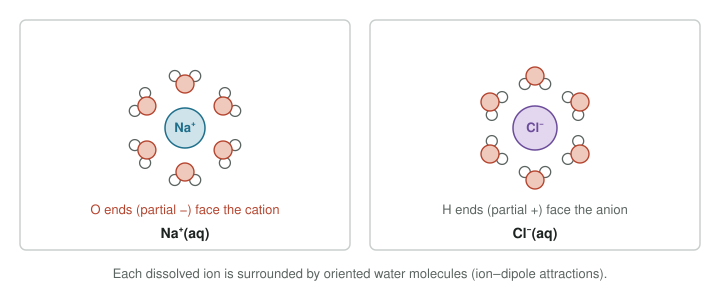

## 1. Solutions in water (4.1)

A **solution** is a homogeneous mixture. The substance present in the largest amount is the
**solvent**; the others are **solutes**. In an **aqueous** solution, written (aq), the solvent is water.
Most of the reactions in this chapter happen in aqueous solution, so the first question is what a solute
looks like once it's dissolved.

## 2. Electrolytes and nonelectrolytes (4.1)

Pure water barely conducts electricity. A solution conducts only if it contains **ions** that can move
through it. That gives three groups:

- A **strong electrolyte** is present in solution almost entirely as ions. The solution conducts well.
- A **weak electrolyte** is present mostly as neutral molecules, with only a small fraction as ions. The
  solution conducts weakly.
- A **nonelectrolyte** dissolves as neutral molecules and forms no ions. The solution doesn't conduct.

## 3. How ionic compounds dissolve (4.1)

Water molecules are polar: the O end carries a partial negative charge and the H ends a partial positive
charge. When an ionic solid dissolves, water molecules pull ions off the surface of the crystal. Each
ion ends up surrounded by water molecules, which point their oppositely charged ends toward it. This is
called **hydration**, and the attractions involved are **ion–dipole** attractions.

The ions separate (**dissociate**) and move independently:

$$
\ce{NaCl(s) -> Na+(aq) + Cl-(aq)}
$$

$$
\ce{Ca(NO3)2(s) -> Ca^2+(aq) + 2NO3^-(aq)}
$$

Polyatomic ions stay in one piece. Calcium nitrate gives $\ce{NO3-}$ ions, never separate N and O atoms.
The subscript on the polyatomic ion (the 2 in $\ce{(NO3)2}$) becomes the coefficient of that ion.

<Reveal label="Worked example: counting ions">

How many moles of each ion, and of ions in total, are in a solution made from 0.25 mol of
$\ce{Al2(SO4)3}$?

$$
\ce{Al2(SO4)3(s) -> 2Al^3+(aq) + 3SO4^2-(aq)}
$$

- $\ce{Al^3+}$: $0.25 \times 2 = 0.50$ mol
- $\ce{SO4^2-}$: $0.25 \times 3 = 0.75$ mol
- Total: $0.50 + 0.75 = 1.25$ mol of ions

Check the charges: $0.50 \times (+3) = +1.50$ and $0.75 \times (-2) = -1.50$. The solution is neutral.

</Reveal>

<Callout type="ap-tip">
AP topic 4.4 asks whether dissolving a salt is a physical or a chemical change, and accepts either answer
**if it's argued from bonds**. Physical: no new substance forms, and evaporating the water gives the salt
back. Chemical: ionic bonds in the crystal break and new ion–dipole attractions form. A claim with no
reasoning about the bonds and attractions earns nothing.
</Callout>

## 4. Molecular compounds in water (4.1)

Most molecular compounds dissolve as whole molecules. Sugar ($\ce{C12H22O11}$), alcohols such as
methanol ($\ce{CH3OH}$) and ethanol ($\ce{C2H5OH}$), and acetone are nonelectrolytes:

$$
\ce{C12H22O11(s) -> C12H22O11(aq)}
$$

Acids are the important exception. They are molecular, but they react with water to make ions
(**ionization**). Some do this completely and some only slightly:

$$
\ce{HCl(aq) -> H+(aq) + Cl-(aq)} \qquad \text{(all of it: strong electrolyte)}
$$

$$
\ce{HF(aq) <=> H+(aq) + F-(aq)} \qquad \text{(a few percent: weak electrolyte)}
$$

The **double arrow** for HF means the reaction goes both ways at once. Ions keep re-forming HF
molecules, so at any moment most of the HF is molecules. Equilibrium is Chapter 15; for now, a double
arrow signals a weak electrolyte.

## 5. Sorting substances

| Strong electrolytes | Weak electrolytes | Nonelectrolytes |
|---|---|---|
| Soluble ionic compounds: NaCl, $\ce{KNO3}$, $\ce{CaCl2}$ | Weak acids: HF, $\ce{HC2H3O2}$, $\ce{HNO2}$ | Most molecular compounds: sugars, alcohols |
| Strong acids: HCl, $\ce{HNO3}$, $\ce{H2SO4}$ | Weak bases: $\ce{NH3}$ | |
| Strong bases: NaOH, KOH, $\ce{Ba(OH)2}$ | | |

To classify a compound:

1. **Is it ionic** (a metal or $\ce{NH4+}$ with a nonmetal or polyatomic anion)? If it dissolves, it's a
   strong electrolyte.
2. **Is it an acid or base?** The strong ones (listed in the acids and bases lesson) are strong
   electrolytes. Every other acid, and ammonia, is weak.
3. **Otherwise** it's a molecular compound and a nonelectrolyte.

<Callout type="warning">
"Strong" describes **what fraction ionizes**, not how much is dissolved. A dilute HCl solution is still a
strong electrolyte, and a concentrated acetic acid solution is still a weak one.
</Callout>

<Reveal label="Worked example: which solution conducts best?">

Equal volumes of 0.10 M solutions of $\ce{CH3OH}$, $\ce{HC2H3O2}$, NaCl, and $\ce{K2SO4}$ are tested.
Rank them from best to worst conductor.

- $\ce{K2SO4}$ gives 3 ions per formula unit: 0.30 M of ions.
- NaCl gives 2 ions: 0.20 M of ions.
- $\ce{HC2H3O2}$ is a weak acid. Only a small fraction ionizes, so far less than 0.10 M of ions.
- $\ce{CH3OH}$ is a nonelectrolyte: no ions.

$\ce{K2SO4}$ > NaCl > $\ce{HC2H3O2}$ > $\ce{CH3OH}$.

</Reveal>
