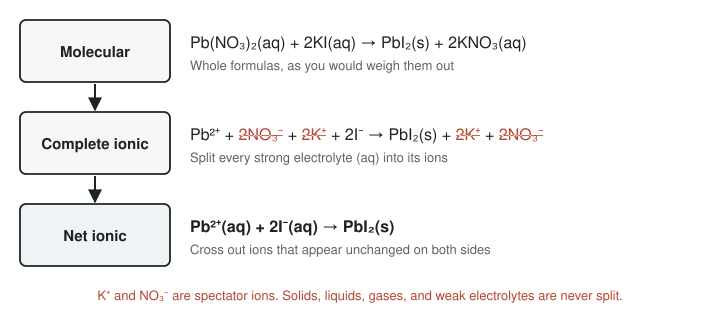

## 1. Precipitation reactions (4.2)

When two solutions of ionic compounds are mixed, a cation from one solution and an anion from the other
sometimes form a compound that doesn't dissolve. It comes out of solution as a solid called a
**precipitate**, and the solution turns cloudy or a solid settles to the bottom.

$$
\ce{AgNO3(aq) + NaCl(aq) -> AgCl(s) + NaNO3(aq)}
$$

## 2. Which compounds dissolve (4.2)

The one rule the AP exam expects you to know:

<Callout type="ap-tip" title="Always soluble">
Every compound containing **$\ce{Na+}$, $\ce{K+}$, $\ce{NH4+}$, or $\ce{NO3-}$** dissolves in water.
For anything else, an AP question tells you whether it dissolves (or shows you a precipitate forming).
</Callout>

A practical result: the spectator ions in almost every precipitation question are these always-soluble
ions. To make insoluble $\ce{PbI2}$, you mix a lead salt with **potassium** iodide, and the lead salt is
usually lead(II) **nitrate**.

<Callout type="not-on-ap" title="The longer solubility guidelines (class only)">
The class covered a longer list of solubility guidelines, so expect it on the test. The AP exam
doesn't ask you to recall it.

| Usually soluble | Exceptions |
|---|---|
| $\ce{NO3-}$ and acetate $\ce{C2H3O2-}$ compounds | none |
| $\ce{Cl-}$, $\ce{Br-}$, $\ce{I-}$ compounds | with $\ce{Ag+}$, $\ce{Hg2^2+}$, $\ce{Pb^2+}$ |
| $\ce{SO4^2-}$ compounds | with $\ce{Sr^2+}$, $\ce{Ba^2+}$, $\ce{Hg2^2+}$, $\ce{Pb^2+}$ |

| Usually insoluble | Exceptions |
|---|---|
| $\ce{S^2-}$ compounds | with $\ce{NH4+}$, group 1 ions, $\ce{Ca^2+}$, $\ce{Sr^2+}$, $\ce{Ba^2+}$ |
| $\ce{CO3^2-}$ and $\ce{PO4^3-}$ compounds | with $\ce{NH4+}$ and group 1 ions |
| $\ce{OH-}$ compounds | with $\ce{NH4+}$, group 1 ions, $\ce{Ca^2+}$, $\ce{Sr^2+}$, $\ce{Ba^2+}$ |
</Callout>

## 3. Exchange reactions (4.2)

Precipitation reactions are **exchange** (or **metathesis**) reactions: the cations and anions trade
partners.

$$
\ce{AX + BY -> AY + BX}
$$

To predict the products, pair each cation with the **other** anion and write correct formulas from the
ion charges. Then decide whether either new compound is insoluble.

<Reveal label="Worked example: predict the precipitate">

Solutions of sodium phosphate and calcium chloride are mixed. Calcium phosphate is insoluble. Write the
balanced molecular equation.

The new pairs are $\ce{Ca^2+}$ with $\ce{PO4^3-}$, and $\ce{Na+}$ with $\ce{Cl-}$.

- $\ce{Ca^2+}$ and $\ce{PO4^3-}$: three $\ce{Ca^2+}$ (+6) balance two $\ce{PO4^3-}$ (−6), so
  $\ce{Ca3(PO4)2}$. It's the precipitate.
- $\ce{Na+}$ and $\ce{Cl-}$: NaCl, which stays dissolved.

$$
\ce{2Na3PO4(aq) + 3CaCl2(aq) -> Ca3(PO4)2(s) + 6NaCl(aq)}
$$

Check: Na 6 = 6, P 2 = 2, O 8 = 8, Ca 3 = 3, Cl 6 = 6.

</Reveal>

If both possible products are soluble, nothing happens. Mixing $\ce{KCl(aq)}$ and $\ce{NaNO3(aq)}$
just gives a solution of four kinds of ions.

## 4. Three ways to write the equation (4.2)

- The **molecular equation** shows whole formulas, as if nothing were ionized.
- The **complete ionic equation** splits every **strong electrolyte** in solution into its ions.
- The **net ionic equation** drops the **spectator ions**, the ions that appear unchanged on both sides.
  It shows only what actually reacts.

What to split, and what to leave together:

| Split into ions | Leave as written |
|---|---|
| Soluble ionic compounds (aq) | Solids (s), including precipitates |
| Strong acids (aq) | Liquids (l), such as $\ce{H2O}$ |
| Strong bases (aq) | Gases (g) |
| | Weak acids and weak bases, such as HF and $\ce{NH3}$ |
| | Molecular compounds |

<Callout type="warning">
A net ionic equation must balance **atoms and charge**. In $\ce{Pb^2+ + 2I- -> PbI2}$, the charge is
$+2 - 2 = 0$ on the left and 0 on the right. If the charges don't match, a coefficient is wrong.
</Callout>

<Reveal label="Worked example: barium sulfate">

Write the net ionic equation for mixing barium chloride and sodium sulfate solutions. Barium sulfate is
insoluble.

**Molecular:**

$$
\ce{BaCl2(aq) + Na2SO4(aq) -> BaSO4(s) + 2NaCl(aq)}
$$

**Complete ionic:**

$$
\ce{Ba^2+(aq) + 2Cl-(aq) + 2Na+(aq) + SO4^2-(aq) -> BaSO4(s) + 2Na+(aq) + 2Cl-(aq)}
$$

**Net ionic:** cross out $\ce{2Na+}$ and $\ce{2Cl-}$:

$$
\ce{Ba^2+(aq) + SO4^2-(aq) -> BaSO4(s)}
$$

Any soluble barium compound mixed with any soluble sulfate gives the same net ionic equation. That's why
net ionic equations are useful: they show the chemistry that all those mixtures share.

</Reveal>

<Reveal label="Worked example: reduce the coefficients">

Write the net ionic equation for

$$
\ce{2AgNO3(aq) + Na2CO3(aq) -> Ag2CO3(s) + 2NaNO3(aq)}
$$

Complete ionic:

$$
\ce{2Ag+ + 2NO3- + 2Na+ + CO3^2- -> Ag2CO3(s) + 2Na+ + 2NO3-}
$$

Net ionic: $\ce{2Ag+(aq) + CO3^2-(aq) -> Ag2CO3(s)}$.

The 2 stays here, because two silver ions are needed for each carbonate. If every coefficient left in a
net ionic equation shares a factor (say, 2, 2, and 2), divide them all by it.

</Reveal>

## 5. Particle diagrams (4.3)

AP questions often show mixing in pictures. In a correct "after" picture:

- the precipitate is drawn as a solid clump of **paired** ions, in the ratio of its formula,
- spectator ions are still **separate** and spread through the solution, in the same numbers as before,
- any ion that was in excess is left over in solution.

For example, if a beaker had 4 $\ce{Ag+}$ and 3 $\ce{Cl-}$ before mixing, the after picture shows 3 AgCl
units in the solid and 1 $\ce{Ag+}$ still dissolved, plus every spectator ion.

<Callout type="ap-tip">
A molecular equation doesn't show what happens to particles, so AP free-response questions usually ask
specifically for the **net ionic** equation. Include states, (aq) and (s), and check the charge balance
before moving on.
</Callout>
