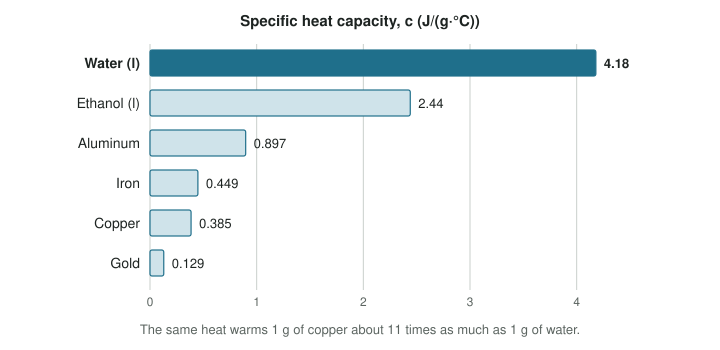
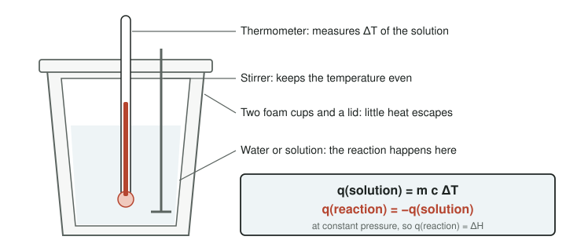

## 1. Heat capacity and specific heat (5.5)

The same amount of heat raises the temperature of different substances by different amounts.

- **Heat capacity** (C) is the heat needed to raise the temperature of an object by 1 °C, in J/°C.
- **Specific heat** (c) is the heat needed to raise **1 gram** of a substance by 1 °C, in J/(g·°C).
- **Molar heat capacity** is the heat needed to raise **1 mole** by 1 °C, in J/(mol·°C).

Water's specific heat is unusually high. That's why the ocean changes temperature slowly and why a metal
pan heats up long before the water in it does. A substance with a **low** specific heat changes
temperature **more** for the same heat.

## 2. q = mcΔT (5.5, AP topic 6.4)

$$
q = mc\Delta T
$$

This is on the equation sheet. $\Delta T = T_\text{final} - T_\text{initial}$, so q comes out positive when
the substance warms up (it absorbed heat) and negative when it cools. A change of 1 °C is the same size as
a change of 1 K, so ΔT is the same in either unit.

Water's specific heat, 4.18 J/(g·°C), isn't on the equation sheet. Questions give it.

<Reveal label="Worked example: heating water">

How much heat raises 250. g of water from 22.0 °C to 85.0 °C?

$$
q = (250.\ \text{g})(4.18\ \text{J/(g·°C)})(85.0 - 22.0\ \text{°C}) = 65{,}800\ \text{J} = 65.8\ \text{kJ}
$$

</Reveal>

## 3. When a hot object meets a cold one (AP topics 6.3 and 6.4)

The heat lost by the hot object is gained by the cold one (if none escapes):

$$
q_\text{hot} + q_\text{cold} = 0
$$

Both objects end at the same final temperature $T_f$. Write each q with $T_f$ in it, add, and solve.

<Reveal label="Worked example: final temperature">

A 50.0 g piece of iron ($c = 0.449$ J/(g·°C)) at 95.0 °C is dropped into 100.0 g of water at 22.0 °C.
What is the final temperature?

$$
(50.0)(0.449)(T_f - 95.0) + (100.0)(4.18)(T_f - 22.0) = 0
$$

$$
22.45\,T_f - 2132.8 + 418\,T_f - 9196 = 0
$$

$$
440.45\,T_f = 11{,}328.8 \qquad T_f = 25.7\ \text{°C}
$$

The water warmed only 3.7 °C while the iron cooled 69.3 °C. The water has far more heat capacity: 418 J/°C
against the iron's 22.45 J/°C.

</Reveal>

<Callout type="warning">
Check that $T_f$ lies **between** the two starting temperatures. An answer outside that range means a sign
error. Writing $\Delta T$ as $T_f - T_i$ for both objects, as above, keeps the signs right automatically.
</Callout>

## 4. Coffee-cup calorimetry (5.5)

A **calorimeter** measures the heat of a process from a temperature change. In class it's often two
nested foam cups with a lid: a constant-pressure calorimeter, so the heat measured is ΔH.

The reaction is the system and the solution is the surroundings. The solution's temperature change shows
how much heat the reaction released or absorbed:

$$
q_\text{rxn} = -q_\text{solution} = -m_\text{solution}\,c\,\Delta T
$$

Then divide by the moles that reacted to get ΔH per mole.

<Reveal label="Worked example: heat of neutralization">

50.0 mL of 1.00 M HCl and 50.0 mL of 1.00 M NaOH, both at 21.0 °C, are mixed in a coffee-cup calorimeter.
The temperature rises to 27.8 °C. Find ΔH per mole of water formed. Assume the solution has a density of
1.00 g/mL and the specific heat of water.

**Heat absorbed by the solution:** 100.0 mL → 100.0 g.

$$
q_\text{soln} = (100.0)(4.18)(27.8 - 21.0) = 2840\ \text{J}
$$

**Heat of the reaction:** $q_\text{rxn} = -2840$ J. (The solution warmed, so the reaction was exothermic.)

**Moles that reacted:** $0.0500\ \text{L} \times 1.00\ M = 0.0500$ mol of each, giving 0.0500 mol of $\ce{H2O}$.

$$
\Delta H = \frac{-2840\ \text{J}}{0.0500\ \text{mol}} = -56{,}800\ \text{J/mol} = -57\ \text{kJ/mol}
$$

Only two significant figures, because $\Delta T = 6.8$ °C has two.

</Reveal>

<Reveal label="Worked example: an endothermic dissolution">

4.00 g of $\ce{NH4NO3}$ is dissolved in 60.0 g of water in a calorimeter, and the temperature drops from
22.0 °C to 17.2 °C. Find ΔH for dissolving $\ce{NH4NO3}$, in kJ/mol.

Mass of solution: $60.0 + 4.00 = 64.0$ g.

$$
q_\text{soln} = (64.0)(4.18)(17.2 - 22.0) = -1280\ \text{J}
$$

$q_\text{rxn} = +1280$ J: the dissolving absorbed heat, so it's endothermic.

Moles: $\mathcal{M}(\ce{NH4NO3}) = 2(14.01) + 4(1.008) + 3(16.00) = 80.05$ g/mol, and
$4.00 / 80.05 = 0.0500$ mol.

$$
\Delta H = \frac{+1.28\ \text{kJ}}{0.0500\ \text{mol}} = +26\ \text{kJ/mol}
$$

</Reveal>

AP topic 6.4 states the rule directly: if the temperature of the mixture **rises**, the process released
energy (exothermic); if it **falls**, the process absorbed energy (endothermic).

## 5. Bomb calorimetry (5.5)

Combustion reactions are measured in a **bomb calorimeter**: a sealed steel container filled with
oxygen, sitting in a bucket of water. The whole apparatus has a known heat capacity $C_\text{cal}$, in
kJ/°C, so

$$
q_\text{rxn} = -C_\text{cal}\,\Delta T
$$

<Reveal label="Worked example: heat of combustion of a fuel">

0.500 g of a fuel burns in a bomb calorimeter with $C_\text{cal} = 10.0$ kJ/°C. The temperature rises by
1.65 °C. How much heat does the fuel release per gram?

$$
q_\text{rxn} = -(10.0\ \text{kJ/°C})(1.65\ \text{°C}) = -16.5\ \text{kJ}
$$

$$
\frac{16.5\ \text{kJ}}{0.500\ \text{g}} = 33.0\ \text{kJ/g released}
$$

</Reveal>

## 6. Errors in calorimetry

AP lab questions ask how a mistake changes the calculated ΔH. Work out what happens to the **measured
ΔT** first.

| Mistake | Measured ΔT | Calculated \|ΔH\| |
|---|---|---|
| Heat escapes through the cup or lid | Smaller than it should be | Too small |
| No lid, or a single thin cup | Smaller | Too small |
| Some of the solid spills before it dissolves | Smaller (less reaction) | Too small, if the full mass is used to find moles |
| The calorimeter itself absorbs heat, and that heat is ignored | Smaller | Too small |

<Callout type="ap-tip">
For an exothermic reaction, a value that's "too small" means **less negative**: −48 kJ/mol instead of −57.
Say which you mean. "The magnitude of ΔH would be too small, because heat lost to the surroundings did not
raise the temperature of the solution" is a complete answer.
</Callout>
