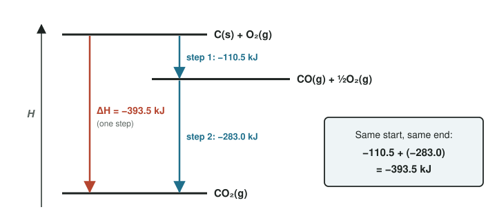

## 1. The idea (5.6)

Carbon can burn straight to carbon dioxide, or it can burn in two steps, first to carbon monoxide and
then to carbon dioxide. Either way it starts as C and $\ce{O2}$ and ends as $\ce{CO2}$, and either way
the total heat released is the same:

**Hess's law**: if a reaction is carried out in a series of steps, ΔH for the overall reaction equals the
sum of ΔH for the steps. It works because the enthalpy change depends only on where the reaction starts
and ends, not on the route between them.

This is useful because many ΔH values can't be measured directly. Nobody can burn carbon to pure CO without
some $\ce{CO2}$ forming, but $\Delta H = -110.5$ kJ for that step can be found from two reactions that are
easy to measure.

## 2. The rules (5.6)

When you rearrange a thermochemical equation, its ΔH follows along:

1. **Reverse** the equation → change the **sign** of ΔH.
2. **Multiply** the equation by a factor → multiply ΔH by the **same factor** (fractions are fine).
3. **Add** equations → **add** their ΔH values. Anything that appears on both sides cancels.

These are the three principles AP topic 6.9 lists.

## 3. Method

1. Write the **target** equation.
2. For each substance in the target, find the given equation it appears in, ideally one where it appears
   only once.
3. **Reverse** that equation if the substance is on the wrong side. **Multiply** it so its coefficient
   matches the target.
4. Add the adjusted equations. Check that everything not in the target cancels, then add the ΔH values.

<Reveal label="Worked example: ΔH for making methane">

Find ΔH for $\ce{C(s) + 2H2(g) -> CH4(g)}$ from:

| | Equation | ΔH (kJ) |
|---|---|---|
| (1) | $\ce{C(s) + O2(g) -> CO2(g)}$ | −393.5 |
| (2) | $\ce{H2(g) + 1/2O2(g) -> H2O(l)}$ | −285.8 |
| (3) | $\ce{CH4(g) + 2O2(g) -> CO2(g) + 2H2O(l)}$ | −890.3 |

- C is a reactant in the target and in (1): **keep (1)**. −393.5
- $\ce{2H2}$ is a reactant in the target; (2) has one: **(2) × 2**. $2(-285.8) = -571.6$
- $\ce{CH4}$ is a **product** in the target but a reactant in (3): **reverse (3)**. +890.3

| Adjusted equation | ΔH (kJ) |
|---|---|
| $\ce{C(s) + O2(g) -> CO2(g)}$ | −393.5 |
| $\ce{2H2(g) + O2(g) -> 2H2O(l)}$ | −571.6 |
| $\ce{CO2(g) + 2H2O(l) -> CH4(g) + 2O2(g)}$ | +890.3 |
| **Sum:** $\ce{C(s) + 2H2(g) -> CH4(g)}$ | **−74.8** |

$\ce{CO2}$, $\ce{2H2O}$, and $\ce{2O2}$ appear on both sides and cancel. **ΔH = −74.8 kJ.**

</Reveal>

<Reveal label="Worked example: acetylene (hard)">

Find ΔH for $\ce{2C(s) + H2(g) -> C2H2(g)}$ from:

| | Equation | ΔH (kJ) |
|---|---|---|
| (1) | $\ce{C2H2(g) + 5/2O2(g) -> 2CO2(g) + H2O(l)}$ | −1299.6 |
| (2) | $\ce{C(s) + O2(g) -> CO2(g)}$ | −393.5 |
| (3) | $\ce{H2(g) + 1/2O2(g) -> H2O(l)}$ | −285.8 |

- $\ce{C2H2}$ is a product in the target: **reverse (1)**: +1299.6
- $\ce{2C}$: **(2) × 2**: −787.0
- $\ce{H2}$: **keep (3)**: −285.8

Check the cancelling: $\ce{2CO2}$ and $\ce{H2O}$ appear on both sides. $\ce{O2}$: $2 + \tfrac{1}{2} = \tfrac{5}{2}$
on the left, and $\tfrac{5}{2}$ on the right. Everything else matches the target.

$$
\Delta H = 1299.6 - 787.0 - 285.8 = +226.8\ \text{kJ}
$$

That is acetylene's ΔH°f, +226.7 kJ/mol in tables, to the precision of the data. Acetylene has more
enthalpy than the elements it's made from, which is part of why it burns so hot in a
welding torch.

</Reveal>

<Reveal label="Worked example: through an intermediate">

Find ΔH for $\ce{N2(g) + 2O2(g) -> 2NO2(g)}$ from:

| | Equation | ΔH (kJ) |
|---|---|---|
| (1) | $\ce{N2(g) + O2(g) -> 2NO(g)}$ | +180.8 |
| (2) | $\ce{2NO(g) + O2(g) -> 2NO2(g)}$ | −113.1 |

The NO made in (1) is used in (2), so adding the two equations as written cancels it:

$$
\Delta H = 180.8 + (-113.1) = +67.7\ \text{kJ}
$$

</Reveal>

<Callout type="warning">
The two most common errors: changing the sign of an equation you didn't reverse, and multiplying the
equation but not its ΔH. Write the adjusted ΔH next to each adjusted equation before adding anything.
</Callout>

<Callout type="ap-tip">
On a free-response question, show each step: which equations you reversed or multiplied, and the ΔH of
each one after the change. A correct final number with no work shown can lose points. AP questions also
ask for the reasoning: "the overall ΔH is the sum of the ΔH values of the steps because the overall
reaction is the sum of the steps."
</Callout>
