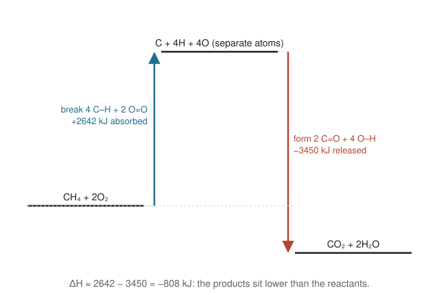

## 1. Bond enthalpy

The book first uses bond enthalpies to estimate ΔH in Chapter 5 (Section 5.8). Section 8.8 comes back
to them to compare how strong and how long different bonds are. Both parts are here.

**Bond enthalpy** is the enthalpy change for breaking **one mole** of a particular bond in a **gaseous**
substance:

$$
\ce{Cl2(g) -> 2Cl(g)} \qquad \Delta H = D(\ce{Cl-Cl}) = 242\ \text{kJ/mol}
$$

Breaking a bond always takes energy, so **bond enthalpies are always positive**. Forming the same bond
releases the same amount.

<Callout type="warning">
"Energy is stored in chemical bonds" is false the way the textbook means it. A bond is a lower-energy
arrangement than the separate atoms, so breaking it never releases energy. When burning a fuel releases
energy, that energy comes from **forming** product bonds that are stronger than the reactant bonds that
were broken.
</Callout>

For a bond that appears in many different molecules, like C–H, the exact value changes a little from
molecule to molecule. Tables list an **average bond enthalpy**.

| Bond | kJ/mol | Bond | kJ/mol | Bond | kJ/mol |
|---|---|---|---|---|---|
| H–H | 436 | C–C | 348 | O–H | 463 |
| C–H | 413 | C=C | 614 | O=O | 495 |
| N–H | 391 | C≡C | 839 | C–O | 358 |
| H–Cl | 431 | N–N | 163 | C=O (in CO₂) | 799 |
| Cl–Cl | 242 | N≡N | 941 | C≡O | 1072 |

## 2. Estimating ΔH from bond enthalpies

A reaction breaks some bonds and forms others. Breaking costs energy and forming releases it:

$$
\Delta H_{\text{rxn}} \approx \sum D(\text{bonds broken}) - \sum D(\text{bonds formed})
$$

**Broken minus formed**, the reverse of the products-minus-reactants order you use with enthalpies of
formation. If the bonds formed are stronger than the bonds broken, ΔH is negative and the reaction is
exothermic.

<Reveal label="Worked example: H₂ + Cl₂ → 2HCl">

Broken: one H–H (436) and one Cl–Cl (242), total 678 kJ.

Formed: two H–Cl, $2 \times 431 = 862$ kJ.

$$
\Delta H \approx 678 - 862 = -184\ \text{kJ}
$$

</Reveal>

<Reveal label="Worked example: burning methane">

$$
\ce{CH4(g) + 2O2(g) -> CO2(g) + 2H2O(g)}
$$

Draw the Lewis structures first so you know every bond: CH₄ has four C–H bonds, each O₂ has one O=O,
CO₂ has two C=O, and each H₂O has two O–H.

| | Bonds | kJ |
|---|---|---|
| Broken | 4 C–H + 2 O=O | $4(413) + 2(495) = 2642$ |
| Formed | 2 C=O + 4 O–H | $2(799) + 4(463) = 3450$ |

$$
\Delta H \approx 2642 - 3450 = -808\ \text{kJ}
$$

The measured value is −802 kJ. The estimate is close but not exact, because the table holds averages.

</Reveal>

<Callout type="warning">
Count bonds per **mole of molecules**, using the coefficients. In the methane example, 2 O₂ means two
O=O bonds, and 2 H₂O means **four** O–H bonds. Forgetting a coefficient is the usual mistake.
</Callout>

A shortcut for bigger molecules: list the bonds on each side and cross out the ones that appear on both.
Only the bonds that change affect ΔH. In $\ce{H2C=CH2 + H2O2 -> HOCH2CH2OH}$, the four C–H and two O–H
bonds are on both sides. What changes is C=C and O–O broken, and one C–C and two C–O formed.

<Callout type="ap-tip">
On the AP exam, bond enthalpies are given in a table when you need them. They're for gas-phase
reactions. When a question asks why a reaction is exothermic, the answer is that **more energy is
released forming the bonds in the products than is absorbed breaking the bonds in the reactants**.
</Callout>

## 3. Bond order, strength, and length

**Bond order** is the number of shared pairs: 1 for a single bond, 2 for a double, 3 for a triple. Between
the same two atoms, a higher bond order means a **stronger** and **shorter** bond, because more shared
electrons between the nuclei pull them closer together.

| Bond | Length (Å) | Bond | Length (Å) | Bond | Length (Å) |
|---|---|---|---|---|---|
| C–C | 1.54 | C–N | 1.43 | C–O | 1.43 |
| C=C | 1.34 | C=N | 1.38 | C=O | 1.23 |
| C≡C | 1.20 | C≡N | 1.16 | C≡O | 1.13 |

Typical bond lengths are **1–2 Å**. A distance of 5–10 Å would span several bonds.

Two details are easy to miss:

- A double bond is **stronger** than a single bond but **not twice** as strong: C=C is 614 kJ/mol, while
  two C–C bonds would be 696.
- Bond length also depends on the **size of the atoms**. Down a group the bonds get longer and usually
  weaker: H–F is shorter and stronger than H–Cl, which is shorter and stronger than H–Br.

For resonance structures, use the averaged bond order from the last lesson. A bond of order 1.5 has a
length between the single and double bond lengths.

The connection between bond length and bond energy is easiest to see on a graph of potential energy vs.
distance between the nuclei. That graph is in the Chapter 9 lesson on orbital overlap.
