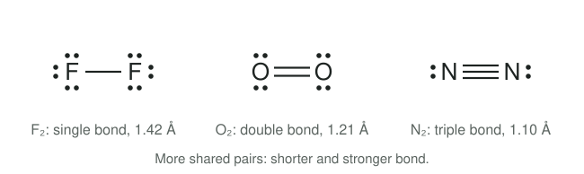
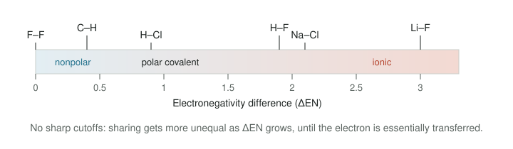

## 1. Covalent bonds (8.3)

Nonmetal atoms don't give up electrons easily, so instead of transferring electrons they **share**
them. In $\ce{H2}$, both nuclei attract the shared pair of electrons sitting between them, and that
attraction holds the atoms together.

In a Lewis structure, each **shared pair** is drawn as a line, and electrons that belong to one atom
only are drawn as dots, called **lone pairs** (or nonbonding pairs).

| Molecule | Bonds to F, O, N, or C | Lone pairs on that atom | Electrons around that atom |
|---|---|---|---|
| $\ce{HF}$ | 1 | 3 on F | 8 |
| $\ce{H2O}$ | 2 | 2 on O | 8 |
| $\ce{NH3}$ | 3 | 1 on N | 8 |
| $\ce{CH4}$ | 4 | 0 on C | 8 |

Each atom ends up with an octet by counting **both** electrons of every bond it's in, plus its own lone
pairs. The bond count matches the Lewis symbols from the last lesson: F makes 1 bond, O 2, N 3, C 4.

### Multiple bonds

Atoms can share more than one pair:

- **single bond**: one shared pair, as in $\ce{H-H}$ or $\ce{Cl-Cl}$
- **double bond**: two shared pairs, as in $\ce{O=O}$ or $\ce{O=C=O}$
- **triple bond**: three shared pairs, as in $\ce{N#N}$

The more pairs two atoms share, the **shorter and stronger** the bond:

| Bond | N–N | N=N | N≡N |
|---|---|---|---|
| Length (Å) | 1.47 | 1.24 | 1.10 |

## 2. Electronegativity (8.4)

**Electronegativity** is an atom's ability to attract the electrons **in a bond** toward itself. The
textbook uses Linus Pauling's scale, which runs from 0.7 (Cs) to 4.0 (F).

| Period | Group 1 | 2 | 13 | 14 | 15 | 16 | 17 |
|---|---|---|---|---|---|---|---|
| 1 | H 2.1 | | | | | | |
| 2 | Li 1.0 | Be 1.5 | B 2.0 | C 2.5 | N 3.0 | O 3.5 | F 4.0 |
| 3 | Na 0.9 | Mg 1.2 | Al 1.5 | Si 1.8 | P 2.1 | S 2.5 | Cl 3.0 |
| 4 | K 0.8 | Ca 1.0 | | | | | Br 2.8 |
| 5 | | | | | | | I 2.5 |

Electronegativity **increases left to right** across a period and **decreases down a group**, the same
direction as ionization energy and for the same reasons (Zeff and distance). Metals have low values and
nonmetals have high ones. The four most electronegative elements are F > O > N ≈ Cl.

<Callout type="warning">
Electronegativity and electron affinity are different. Electron affinity is an energy change for an
isolated gaseous atom gaining an electron. Electronegativity describes a pull on shared electrons in a
bond and has no units.
</Callout>

## 3. Bond polarity

The **difference in electronegativity** (ΔEN) between two bonded atoms tells you how evenly the
electrons are shared:

| Bond type | ΔEN | Example | What happens |
|---|---|---|---|
| **Nonpolar covalent** | 0 (or very small) | F–F: 4.0 − 4.0 = 0 | electrons shared equally |
| **Polar covalent** | in between | H–F: 4.0 − 2.1 = 1.9 | electrons pulled toward F |
| **Ionic** | large (around 2 or more) | Li–F: 4.0 − 1.0 = 3.0 | electron essentially transferred to F |

H–F, at 1.9, is close to the boundary but is still a molecule with a polar covalent bond.

These are points on a **continuum**, not separate boxes, so there's no exact cutoff. A C–H bond (ΔEN =
0.4) is usually treated as nonpolar.

In a polar bond the more electronegative atom gets a **partial negative charge** (δ−), and the other gets
a **partial positive charge** (δ+):

$$
\overset{\delta+}{\ce{H}}-\overset{\delta-}{\ce{F}}
$$

The bond can also be drawn with a crossed arrow (+→) pointing toward the δ− end.

<Reveal label="Worked example: order bonds by polarity">

Put these bonds in order of increasing polarity: C–O, C–F, C–N, C–C.

ΔEN values: C–C 0, C–N 0.5, C–O 1.0, C–F 1.5.

Increasing polarity: **C–C < C–N < C–O < C–F**. In every polar one, carbon is the δ+ end.

</Reveal>

## 4. Dipole moments

Two equal and opposite charges separated by a distance form a **dipole**. Its size is the **dipole
moment**, $\mu = Q\,r$, where $Q$ is the size of the charge on each end and $r$ is the distance
between them. You won't calculate it in this class, but the relationship tells you what makes a
dipole bigger:

- **larger partial charges**, which come from a bigger ΔEN, or
- **a longer bond**, which separates those charges more.

Of the two, ΔEN usually wins. From HF to HI the bond gets longer, but ΔEN falls from 1.9 to 0.4, so
the partial charges shrink far more than the distance grows. HF has the largest dipole moment of the
hydrogen halides and HI the smallest.

<Callout type="note">
Dipole moments are only compared in this class, never calculated. Know which bonds are more polar,
which end is δ−, and that a bigger ΔEN means a bigger bond dipole (AP topic 2.1).
</Callout>

## 5. Ionic or covalent?

"Metal + nonmetal = ionic" is a good first guess, and the ΔEN guide above usually agrees. But the
textbook points out exceptions: when a metal is in a **high oxidation state** (about +4 or higher), its
compounds behave like molecules.

- $\ce{TiCl4}$ (titanium in the +4 state) is a **liquid** at room temperature that boils at 136 °C. An
  ionic solid would melt hundreds of degrees higher.
- $\ce{MnO}$ (Mn in the +2 state) is an ionic solid with a high melting point, while $\ce{Mn2O7}$ (Mn
  in the +7 state) is a liquid at room temperature.

Names follow the same split. Compounds that behave ionically get ionic names, like **manganese(II)
oxide**, while molecular ones are often given molecular names, like **dimanganese heptoxide** or
**titanium tetrachloride**.

### Sorting substances by bond type

| Substance | Bonding | Why |
|---|---|---|
| iron | metallic | metal atoms only |
| sodium chloride | ionic | metal + nonmetal, $\ce{Na+}$ and $\ce{Cl-}$ ions |
| water | covalent | two nonmetals sharing electrons |
| oxygen, $\ce{O2}$ | covalent | two O atoms sharing electrons (a double bond) |
| argon | **none** | a noble gas exists as single atoms, so there are no bonds at all |

A low boiling point is a clue too. Boiling an ionic compound means pulling ions apart, so ionic
compounds boil at hundreds or thousands of degrees (NaCl boils at 1413 °C). A compound of two elements
that boils at −33 °C must be made of separate molecules held together only by weak forces, so it's
covalent. ($\ce{NH3}$ is one: it boils at −33 °C.)

<Callout type="ap-tip">
On the AP exam, the type of bond is usually judged from the elements (metal and nonmetal vs. two
nonmetals) and the electronegativity difference. Explain polarity with electronegativity, not with
"wanting electrons."
</Callout>
