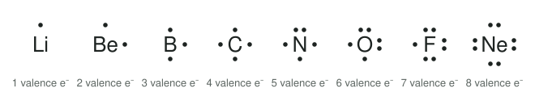
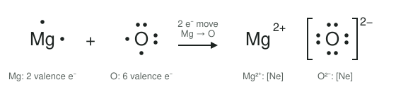
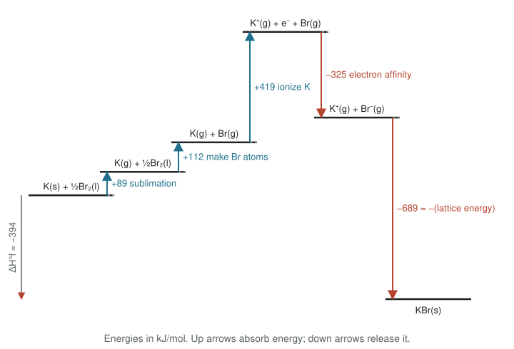

## 1. Three kinds of bonds

A **chemical bond** is the attraction that holds atoms together. Chapter 8 sorts bonds into three types:

| Bond | Between | What happens to the electrons | Example |
|---|---|---|---|
| **Ionic** | a metal and a nonmetal | transferred from the metal to the nonmetal, making ions that attract each other | $\ce{NaCl}$ |
| **Covalent** | nonmetals | shared between two atoms | $\ce{H2O}$, $\ce{Cl2}$ |
| **Metallic** | metal atoms | free to move through the whole solid; each metal atom is held by the "sea" of electrons around it | $\ce{Cu}$, $\ce{Fe}$ |

This lesson covers ionic bonds. The next one covers covalent bonds.

## 2. Lewis symbols and the octet rule (8.1)

Only valence electrons take part in bonding. A **Lewis symbol** is the element's symbol with one dot for
each valence electron. Put the dots on the four sides of the symbol, one per side, before pairing any up.

The number of dots equals the group number for groups 1–2 and the group number minus 10 for groups 13–18.

The number of **unpaired** dots tells you how many bonds a nonmetal usually makes: C makes 4, N makes 3,
O makes 2, and F makes 1.

The **octet rule**: atoms tend to gain, lose, or share electrons until they are surrounded by **eight
valence electrons**, the configuration of a noble gas ($ns^2\,np^6$). Hydrogen is the exception that
stops at two, like He. The rule has many exceptions (Section 8.7), but it works for most compounds of
period 2 elements.

## 3. Why ionic compounds form (8.2)

When sodium metal reacts with chlorine gas, an electron moves from each Na to a Cl:

$$
\ce{Na(s) + 1/2 Cl2(g) -> NaCl(s)} \qquad \Delta H^\circ_f = -411\ \text{kJ}
$$

The reaction is strongly exothermic, but the electron transfer itself is not where the energy comes from:

- Removing Na's electron **costs** 496 kJ/mol (its first ionization energy).
- Adding that electron to Cl **releases** only 349 kJ/mol (its electron affinity is −349 kJ/mol).

Making a gaseous $\ce{Na+}$ and a gaseous $\ce{Cl-}$ from the atoms is therefore **uphill** by about 147
kJ/mol. What makes the compound stable is the huge amount of energy released when the oppositely charged
ions pack together into a solid. That energy is the lattice energy.

<Callout type="warning">
Ionic compounds don't form "because the atoms want an octet." Losing an electron always costs energy.
They form because the attraction between the ions in the solid releases far more energy than the
electron transfer costs.
</Callout>

### Showing the transfer with Lewis symbols

Lewis symbols show where the electrons go. Magnesium's two valence electrons move to oxygen, which
fills oxygen's two unpaired spots:

Draw the anion in **brackets** with its charge outside, and leave the cation with no dots. The two ions
are written side by side without a plus sign, because together they are the one product, MgO. (On paper
you can add curved arrows from each Mg dot to O to show the transfer.)

### Predicting the formula

Take each ion's charge from its group, then use the smallest whole-number ratio that makes the total
charge zero:

| Group | 1 | 2 | 13, plus Sc and Y | 15 | 16 | 17 |
|---|---|---|---|---|---|---|
| Ion charge | +1 | +2 | +3 | −3 | −2 | −1 |

| Elements | Ions | Formula |
|---|---|---|
| Al and F | $\ce{Al^3+}$, $\ce{F-}$ | $\ce{AlF3}$ |
| K and S | $\ce{K+}$, $\ce{S^2-}$ | $\ce{K2S}$ |
| Mg and N | $\ce{Mg^2+}$, $\ce{N^3-}$ | $\ce{Mg3N2}$: $3(+2) = +6$ balances $2(-3) = -6$ |
| Y and O | $\ce{Y^3+}$, $\ce{O^2-}$ | $\ce{Y2O3}$: $2(+3) = +6$ balances $3(-2) = -6$ |

Yttrium is $[\ce{Kr}]\,4d^1 5s^2$. Its 4d electron is in a lower shell than the 5s electrons, but the
4d and 5s energies are close, so all three count as valence electrons. Losing all three leaves
$\ce{Y^3+}$ as $[\ce{Kr}]$. Scandium, one row up, does the same thing and forms $\ce{Sc^3+}$.

## 4. Lattice energy

**Lattice energy** is the energy required to **completely separate one mole** of a solid ionic compound
into its **gaseous ions**:

$$
\ce{NaCl(s) -> Na+(g) + Cl-(g)} \qquad \Delta H_{\text{lattice}} = +788\ \text{kJ/mol}
$$

It is always **positive**, because you're pulling apart ions that attract each other. A larger lattice
energy means a more stable solid, with stronger attractions between its ions.

### Coulomb's law sets the size

The potential energy of two interacting charged particles is

$$
E_{\text{el}} = \frac{\kappa\, Q_1 Q_2}{d}
$$

where $Q_1$ and $Q_2$ are the charges on the ions and $d$ is the distance between their centers. So
lattice energy:

1. **increases as the ion charges increase** (the product $Q_1 Q_2$ goes up), and
2. **increases as the ions get smaller** (smaller ions sit closer together, so $d$ is smaller).

Charge usually matters more than size. Going from +1/−1 ions to +2/−2 ions multiplies $Q_1 Q_2$ by 4, while
changing to the next ion down a group with the same charge changes $d$ by roughly 10–15% (NaCl to KCl
takes $d$ from about 2.8 Å to 3.2 Å).

| Compound | Ion charges | Lattice energy (kJ/mol) |
|---|---|---|
| $\ce{KCl}$ | +1, −1 | 701 |
| $\ce{NaCl}$ | +1, −1 | 788 |
| $\ce{LiF}$ | +1, −1 | 1030 |
| $\ce{MgCl2}$ | +2, −1 | 2326 |
| $\ce{CaO}$ | +2, −2 | 3414 |
| $\ce{MgO}$ | +2, −2 | 3795 |

Among the +1/−1 salts, the smaller ions give the larger lattice energy (LiF > NaCl > KCl). Every compound
with a +2 ion is far above all of them. Comparing different formula types is less direct: MgCl₂ is about
three times NaCl, not twice, partly because each formula unit has three ions instead of two.

<Reveal label="Worked example: rank by lattice energy">

Rank $\ce{NaF}$, $\ce{CaO}$, and $\ce{NaBr}$ from smallest to largest lattice energy.

- $\ce{CaO}$ has +2 and −2 ions. Its charge product (4) is four times the others' (1), so it's the
  largest by far.
- $\ce{NaF}$ and $\ce{NaBr}$ both have +1/−1 ions and the same cation. $\ce{F-}$ is smaller than
  $\ce{Br-}$, so the ions in NaF are closer together and attract more strongly.

Smallest to largest: $\ce{NaBr} < \ce{NaF} < \ce{CaO}$.

</Reveal>

### Properties of ionic solids

The ions sit in a repeating three-dimensional **lattice**, each cation surrounded by anions and each
anion by cations. That structure explains how ionic solids behave:

- **High melting points**, because many strong attractions have to be overcome. Higher lattice energy
  generally means a higher melting point (MgO melts near 2800 °C, NaCl at 801 °C).
- **Brittle**: a sharp blow shifts one layer of ions, lining up like charges, and the repulsion splits
  the crystal.
- **Don't conduct as solids**, because the ions are locked in place. **Do conduct when melted or
  dissolved in water**, because the ions can then move.

<Callout type="ap-tip">
The AP exam asks you to compare lattice energies, melting points, or attractions between ions using
Coulomb's law. Name both factors in your answer: the **charges** of the ions and the **distance**
between them (the ionic radii).
</Callout>

## 5. The Born–Haber cycle

Lattice energy can't be measured directly. Instead the formation of the solid from its elements is
broken into steps whose energies are known, and Hess's law gives the missing step. That cycle of steps
is called a **Born–Haber cycle**.

For a compound MX made from a metal M and a diatomic halogen $\ce{X2}$:

| Step | Energy |
|---|---|
| 1. $\ce{M(s) -> M(g)}$ | enthalpy of sublimation (+) |
| 2. $\ce{1/2 X2 -> X(g)}$ | half the X–X bond enthalpy (+); for $\ce{Br2(l)}$ or $\ce{I2(s)}$, the formation enthalpy of the gaseous atom |
| 3. $\ce{M(g) -> M+(g) + e-}$ | first ionization energy (+) |
| 4. $\ce{X(g) + e- -> X-(g)}$ | electron affinity (−) |
| 5. $\ce{M+(g) + X-(g) -> MX(s)}$ | **−(lattice energy)** |
| Sum: $\ce{M(s) + 1/2 X2 -> MX(s)}$ | $\Delta H^\circ_f$ of MX |

So

$$
\Delta H^\circ_f = \Delta H_{\text{sub}} + \tfrac{1}{2}D + \text{IE}_1 + \text{EA} - \Delta H_{\text{lattice}}
$$

Rearranged, $\Delta H_{\text{lattice}} = \Delta H_{\text{sub}} + \tfrac{1}{2}D + \text{IE}_1 + \text{EA} - \Delta H^\circ_f$.

<Reveal label="Worked example: lattice energy of KBr">

Use these values (kJ/mol) to find the lattice energy of KBr.

| $\ce{K(s) -> K(g)}$ | $\ce{1/2 Br2(l) -> Br(g)}$ | IE₁ of K | EA of Br | $\Delta H^\circ_f$ of KBr(s) |
|---|---|---|---|---|
| +89 | +112 | +419 | −325 | −394 |

$$
\Delta H_{\text{lattice}} = 89 + 112 + 419 + (-325) - (-394) = +689\ \text{kJ/mol}
$$

Watch the last term. Subtracting a negative $\Delta H^\circ_f$ **adds** 394.

Tables built from other data list about 671 kJ/mol for KBr. The cycle's answer depends on the values
put into it, so use the numbers the question gives.

</Reveal>

<Callout type="not-on-ap">
Born–Haber calculations aren't in the AP course framework; the AP exam compares lattice energies
with Coulomb's law. The class may still ask for them.
</Callout>

## 6. Electron configurations of ions

Ions of the **group 1 and 2 metals, aluminum, and the nonmetals** reach a noble-gas configuration:

- Metals lose their valence electrons: $\ce{Mg}$ $[\ce{Ne}]\,3s^2 \to \ce{Mg^2+}$ $[\ce{Ne}]$.
- Nonmetals gain electrons to fill their p subshell: $\ce{N}$ $[\ce{He}]\,2s^2 2p^3 \to \ce{N^3-}$
  $[\ce{He}]\,2s^2 2p^6 = [\ce{Ne}]$.

Ions don't go past a noble-gas configuration, because removing a core electron costs far more energy
than the lattice can pay back. That's why sodium forms $\ce{Na+}$ and never $\ce{Na^2+}$.

Heavier main-group metals past the transition metals don't all reach a noble-gas configuration.
$\ce{Ga^3+}$ is $[\ce{Ar}]\,3d^{10}$, a filled d subshell instead.

**Transition-metal ions** lose their **ns electrons first**, then (n − 1)d electrons, even though 4s
filled before 3d:

$$
\ce{Fe}\ [\ce{Ar}]\,3d^6 4s^2 \;\to\; \ce{Fe^2+}\ [\ce{Ar}]\,3d^6 \;\to\; \ce{Fe^3+}\ [\ce{Ar}]\,3d^5
$$

Most transition-metal ions don't have noble-gas configurations, which is part of why many of these
metals form more than one ion.

<Callout type="warning">
A common mistake is to write $\ce{Fe^2+}$ as $[\ce{Ar}]\,3d^4 4s^2$, removing the 3d electrons first.
The 4s electrons are lost first.
</Callout>

### Noble-gas shorthand is not the same as a noble-gas configuration

Almost any ion can be **written** with noble-gas shorthand: $\ce{Rh^3+}$ is $[\ce{Kr}]\,4d^6$. That's
just notation. An ion **has** a noble-gas configuration only when its whole arrangement matches a noble
gas, with nothing written after the bracket.

| Ion | Configuration | Noble-gas configuration? |
|---|---|---|
| $\ce{Rb+}$ | $[\ce{Kr}]$ | yes (Kr) |
| $\ce{Sc^3+}$ | $[\ce{Ar}]$ | yes (Ar) |
| $\ce{P^3-}$, $\ce{S^2-}$ | $[\ce{Ne}]\,3s^2 3p^6 = [\ce{Ar}]$ | yes (Ar) |
| $\ce{V^2+}$ | $[\ce{Ar}]\,3d^3$ | no |
| $\ce{Rh^3+}$ | $[\ce{Kr}]\,4d^6$ | no |

Rhodium is $[\ce{Kr}]\,4d^8 5s^1$, an exception to the filling order. It loses the 5s electron first,
then two 4d electrons, and ends at $[\ce{Kr}]\,4d^6$.
