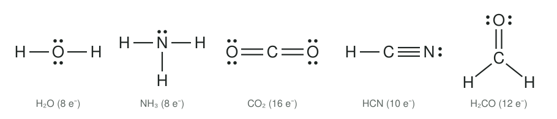
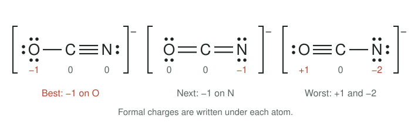
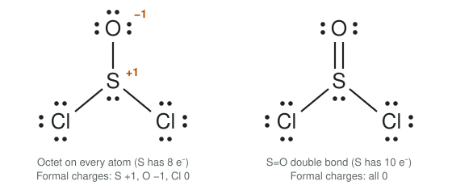
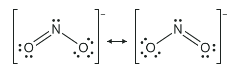
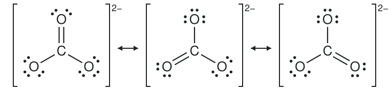
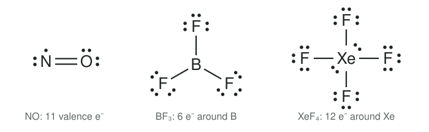

## 1. Drawing a Lewis structure (8.5)

1. **Add up the valence electrons** of all the atoms. For an **anion**, add one electron per negative
   charge. For a **cation**, subtract one per positive charge.
2. **Write the skeleton** and connect the atoms with single bonds. The **central atom is usually the
   least electronegative** one, and it's usually written first in the formula. **H and F are never
   central**, because each makes only one bond. In **oxyacids** (HOCl, HNO₃, H₂SO₄), each H is bonded
   to an O, not to the central atom. If two skeletons both work, formal charge (Section 2) decides.
3. **Complete the octets of the outer atoms** with lone pairs (H gets only the 2 electrons in its bond).
4. **Put any leftover electrons on the central atom**, in pairs.
5. **If the central atom has fewer than 8 electrons**, move lone pairs from outer atoms into the bonds
   to make **double or triple bonds**, one pair at a time, until it has an octet.

At the end, count again: the dots and bond electrons together must equal the total from step 1.

<Reveal label="Worked example: PCl₃">

1. P has 5 valence electrons and each Cl has 7: $5 + 3(7) = 26$.
2. P is less electronegative than Cl, so P is central, with three P–Cl bonds. That uses 6 electrons.
3. Each Cl needs 3 lone pairs: $3 \times 6 = 18$ more. Running total: 24.
4. The 2 left over go on P as a lone pair.
5. P now has three bonds and a lone pair, which is 8 electrons. Done.

</Reveal>

<Reveal label="Worked example: HCN">

1. $1 + 4 + 5 = 10$ valence electrons.
2. H–C–N with two single bonds uses 4. H can't be central.
3. N gets 3 lone pairs (6 electrons). Running total: 10, so nothing is left.
4. No leftovers.
5. C has only 4 electrons (two bonds). Move two of N's lone pairs into the C–N bond, making it triple.
   Now C has 8 (one single bond + one triple bond), and N has 8 (triple bond + one lone pair).

Result: H–C≡N with one lone pair on N.

</Reveal>

<Callout type="warning">
Don't bond two O atoms together unless the problem says the compound is a **peroxide** (like
$\ce{H2O2}$). O–O bonds are weak and rare. Chlorous acid, $\ce{HClO2}$, is H–O–Cl–O with both O atoms
on Cl. You can draw H–O–O–Cl with 20 electrons and every formal charge 0, but it's a different molecule.
Formal charge only compares structures that have the **same atoms connected** to each other.
</Callout>

## 2. Formal charge

Sometimes more than one structure follows every rule. **Formal charge** helps pick the best one. It's
the charge an atom would have if every bond were shared **exactly equally**:

$$
\text{formal charge} = (\text{valence electrons}) - (\text{lone-pair electrons}) - \tfrac{1}{2}(\text{bonding electrons})
$$

A shortcut for the last two terms: count **every lone-pair dot** plus **one per bond line**. Then
subtract that count from the atom's valence electrons.

The formal charges in a structure always add up to the **overall charge** (0 for a neutral molecule).

**Choosing the best structure:**

1. Prefer the structure where the formal charges are **as close to zero as possible**.
2. If some negative formal charge is needed, it belongs on the **more electronegative** atom.

<Reveal label="Worked example: why CO₂ is O=C=O">

Another structure with 16 electrons and octets everywhere is O≡C–O, with one lone pair on the
triple-bonded O and three on the single-bonded O.

| Atom in O≡C–O | Valence e⁻ | Lone-pair e⁻ | Bonds | Formal charge |
|---|---|---|---|---|
| O (triple) | 6 | 2 | 3 | +1 |
| C | 4 | 0 | 4 | 0 |
| O (single) | 6 | 6 | 1 | −1 |

In O=C=O every atom has a formal charge of 0, so O=C=O is the better structure.

</Reveal>

The cyanate ion, $\ce{OCN-}$ (16 valence electrons), has three structures with octets on every atom. All
three have formal charges adding to −1, but they are not equally good:

The first two each have only one nonzero formal charge, so the tiebreaker decides: the first is best
because its −1 sits on oxygen, the most electronegative atom. The third puts a positive charge on oxygen and a −2 on nitrogen, so it contributes almost nothing.

### Formal charge vs. oxidation number

Both are bookkeeping, and they make opposite assumptions:

- **Formal charge** pretends bonding electrons are shared **equally**.
- **Oxidation number** pretends they belong entirely to the **more electronegative** atom.

In CO₂, carbon's formal charge is 0, but its oxidation number is +4. Neither is the atom's real charge,
which is somewhere in between. Formal charge also isn't used to find a dipole moment, which depends on
the real partial charges (δ+ and δ−).

### "Obey the octet rule" vs. "minimize formal charge"

For molecules with a period 3 central atom, these two instructions can give different structures.
Thionyl chloride, $\ce{SOCl2}$ (S central, 26 valence electrons), is the standard example:

- If the question says **obey the octet rule**, draw the single-bond structure on the left.
- If it says **minimize formal charge**, draw the S=O structure on the right. S can hold 10 electrons
  because it's in period 3.

<Reveal label="Worked example: octet structures with formal charges and oxidation numbers">

Each structure below obeys the octet rule. The formal charges and the oxidation numbers each add up to
the overall charge.

| Species | Octet structure | Formal charges | Oxidation numbers |
|---|---|---|---|
| OCS | O=C=S | all 0 | O −2, C +4, S −2 |
| $\ce{SOCl2}$ | S bonded to O and 2 Cl, one lone pair on S | S +1, O −1, Cl 0 | S +4, O −2, Cl −1 |
| $\ce{BrO3-}$ | Br bonded to 3 O, one lone pair on Br | Br +2, each O −1 | Br +5, O −2 |
| $\ce{HClO2}$ | H–O–Cl–O, all single bonds | H 0, O(H) 0, Cl +1, end O −1 | H +1, Cl +3, O −2 |

The formal charge on Cl in $\ce{HClO2}$, step by step (2 lone pairs, 2 bonds):

$$
\text{FC} = 7 - 4 - \tfrac{1}{2}(4) = +1
$$

</Reveal>

Sulfuric acid, $\ce{H2SO4}$ (32 valence electrons, each H on an O), works the same way. The octet
structure has four S–O single bonds, with S at +2 and the two O atoms without H at −1. Changing those two
bonds to S=O makes every formal charge 0 and puts **12 electrons** around S.

## 3. Resonance (8.6)

Some molecules can't be described by one Lewis structure. In the nitrite ion, $\ce{NO2-}$, the double
bond can be drawn to either oxygen:

Experiments show **both N–O bonds are identical**: same length, shorter than an N–O single bond and
longer than an N=O double bond. Neither drawing is right on its own. The real ion is a **resonance
hybrid**, a blend of both, with the extra bonding spread evenly over the two N–O bonds. Ozone, $\ce{O3}$,
works exactly the same way.

<Callout type="warning">
The ion does **not** flip back and forth between the resonance structures. It is the hybrid all the time.
</Callout>

Rules for resonance structures:

- Only **electrons** move (lone pairs and the second or third pair of a multiple bond). **Atoms stay in
  the same places.**
- Every resonance structure has the same total number of electrons.
- Draw them with a **double-headed arrow** (↔) between them.

**Bond order** in a resonance hybrid is the average over the structures. The carbonate ion has three:

Each C–O bond is a double bond in one structure and a single bond in two, so its bond order is
$(2 + 1 + 1)/3 = 4/3$. Nitrate, $\ce{NO3-}$, also has three resonance structures and the same 4/3 bond
order. In nitrite and ozone, each bond has order $(2 + 1)/2 = 3/2$.

**Sulfur dioxide**, $\ce{SO2}$, has 18 valence electrons, the same as ozone, because S and O are both in
group 16. Species with the same number of electrons are **isoelectronic**. Ozone is an **allotrope** of
oxygen: one of the forms an element can take in the same physical state ($\ce{O2}$ and $\ce{O3}$ are both
oxygen gases; diamond and graphite are both solid carbon). Like ozone, $\ce{SO2}$ has two equivalent
resonance structures (O=S–O and O–S=O, lone pair on S), so both S–O bonds have order 3/2. They are the
same length, shorter than an S–O single bond and longer than an S=O double bond.

**Sulfur trioxide**, $\ce{SO3}$, drawn with an octet on S, has one S=O and two S–O bonds, so it has three
equivalent resonance structures. All three real bonds are the same (order 4/3). The S atom has four
bonds and no lone pairs, so its formal charge is $6 - 0 - 4 = +2$.

### Benzene

Benzene, $\ce{C6H6}$, is a ring of six carbons with alternating single and double bonds, and the double
bonds can be drawn in two different positions. All six C–C bonds are really the same length, 1.40 Å,
between a C–C single bond (1.54 Å) and a C=C double bond (1.34 Å). Chemists often draw it as a hexagon
with a circle inside to show the electrons spread around the ring.

## 4. Exceptions to the octet rule (8.7)

### Odd number of electrons

If the total number of valence electrons is **odd**, one electron has to be unpaired. Examples are
$\ce{NO}$ (11), $\ce{NO2}$ (17), $\ce{ClO}$ (13), and $\ce{ClO2}$ (19). These molecules are called
**radicals**, and they're usually very reactive. Compare the chlorine–oxygen ions $\ce{ClO-}$ (14),
$\ce{ClO2-}$ (20), $\ce{ClO3-}$ (26), and $\ce{ClO4-}$ (32): each has an even count, and each can be drawn
with an octet on every atom.

### Fewer than an octet

**Boron** and **beryllium** often end up with fewer than 8 electrons. In $\ce{BF3}$, boron has only 6.
You could give it an octet with a B=F double bond, but that puts a +1 formal charge on fluorine, the most
electronegative element, so the 6-electron structure is the better one.

Boron's empty spot makes $\ce{BF3}$ reactive toward molecules with a lone pair. With ammonia, the N lone
pair forms a bond to B, and B gets its octet:

$$
\ce{BF3 + NH3 -> F3B-NH3}
$$

### More than an octet

Atoms from **period 3 and below** (P, S, Cl, Xe, I, and so on) can have **more than 8 electrons**
around them: $\ce{PCl5}$ has 10 around P, $\ce{SF6}$ has 12 around S, and $\ce{XeF4}$ has 12 around Xe
(four bonds and two lone pairs). Period 2 atoms (C, N, O, F) **never** do.

The reason is mostly **size**. A larger central atom has room for five or six atoms around it. Small
period 2 atoms don't.

When drawing these, follow steps 1–4 as usual. After every outer atom has its octet, the leftover
electrons go on the central atom, even if it already has 8.

<Reveal label="Worked example: ICl₄⁻">

1. $7 + 4(7) + 1 = 36$ electrons.
2. I is central with four I–Cl bonds: 8 electrons.
3. Each Cl gets 3 lone pairs: $4 \times 6 = 24$. Running total: 32.
4. The last 4 electrons go on I as **two lone pairs**. I has 4 bonds + 2 lone pairs = 12 electrons.

</Reveal>

<Callout type="note">
For ions like phosphate ($\ce{PO4^3-}$) and sulfate ($\ce{SO4^2-}$), you can draw a structure with an
octet on the central atom (all single bonds, with formal charges) or an expanded one with P=O or S=O
double bonds that lowers the formal charges. Theory calculations favor the octet version, but both are
common in books. Use the one your teacher uses.
</Callout>
