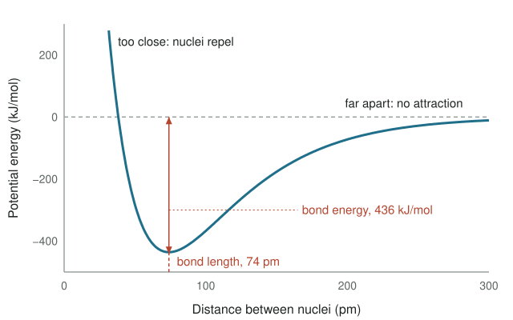

<Callout type="ap-tip" title="What's on the AP exam from this lesson">
**On the exam (topics 2.2 and 2.7):** the potential-energy curve for a bond; naming an atom's
hybridization as sp, sp², or sp³ and matching it to 180°, 120°, or 109.5°; σ and π bonds (counting them,
π weaker than σ, no rotation around a double bond).

**Class only:** how hybrid orbitals are formed and drawn (promotion, box diagrams of hybridization,
mixing), sp³d and sp³d², and the orbital picture of delocalized π bonds. Each section below says which it is.
</Callout>

VSEPR predicts shapes but doesn't say how the electrons actually form bonds. **Valence-bond theory**
connects bonds to the atomic orbitals from Chapter 6.

## 1. Bonds form by orbital overlap (9.4)

A covalent bond forms when an orbital on one atom **overlaps** an orbital on another, and the two
electrons (one from each atom, with opposite spins) share the overlap region between the nuclei. Both
nuclei attract that shared pair.

How close do the atoms get? The graph shows the potential energy of two H atoms as they approach:

- **Far apart**, the atoms don't interact: energy is zero.
- **Closer**, the orbitals overlap and each nucleus attracts the other's electron, so the energy drops.
- **Too close**, the two positive nuclei (and the electrons) repel, and the energy shoots up.
- The **minimum** is the most stable distance. Its distance is the **bond length** (74 pm for H₂), and
  its depth below zero is the **bond energy** (436 kJ/mol), the energy needed to pull the atoms apart.

<Callout type="ap-tip">
This graph is AP topic 2.2. Compared with a weaker bond between the same atoms, a **higher bond
order** gives a **deeper** well (more energy to break) at a **shorter** distance. **Larger atoms** move
the minimum to a **longer** distance.
</Callout>

## 2. Hybrid orbitals (9.5)

Unhybridized atomic orbitals can't explain most shapes. Carbon's valence orbitals are one 2s and three
2p orbitals at 90° to each other, yet methane's four C–H bonds are identical and 109.5° apart.

The fix: the atom **mixes** some of its valence orbitals to make an equal number of new, identical
**hybrid orbitals** that point toward the electron domains. **Count the electron domains on the atom
and you have the hybridization**: each domain (bond or lone pair, with a multiple bond counting once)
needs one hybrid orbital.

<HybridCards />

Questions about hybridization ask about **central or interior atoms** (any atom bonded to two or
more others). An outer atom such as an F in BF₃ isn't usually given a hybridization.

### What happens, step by step

<Callout type="not-on-ap" title="This part is class-only">
The AP Course and Exam Description says "an understanding of the derivation and depiction of hybrid
orbitals will not be assessed on the AP Exam." Promotion, orbital box diagrams, and drawing the lobes
are how your class and textbook explain hybridization, but the AP exam only asks you to **name** sp, sp²,
or sp³ and connect it to 180°, 120°, or 109.5°.
</Callout>

Pick a molecule, then step through it. The box diagram under the model shows the same thing as
energy levels: the highlighted column matches the step you're on.

<OrbitalViewer ids="ch4,nh3,h2o,bf3,bef2" boxes />

What happens in each step:

1. **Atomic orbitals.** The central atom starts with one 2s and three 2p orbitals. The 2p orbitals point
   along x, y, and z, at 90° to each other.
2. **Promotion** (only Be, B, and C). These atoms have fewer unpaired electrons than bonds to make, so one
   2s electron moves up into an empty 2p orbital. That costs energy, which forming the extra bonds pays
   back. N and O already have enough unpaired electrons and skip this step.
3. **Mixing.** The 2s and some of the 2p orbitals combine into the same number of hybrid orbitals. Each
   hybrid has one big lobe (where the bond or lone pair goes) and a small lobe behind it. They're all
   identical and point as far apart as possible: the VSEPR geometry.
4. **Filling.** The electrons go one per hybrid first. Any left over go one each into the leftover p
   orbitals (those are what form π bonds, section 3), and any still left pair up in hybrids as **lone
   pairs** (N has one, O has two). B and Be run out first, so in BF₃ and BeF₂ the leftover p orbitals
   stay empty.
5. **Overlap.** Each half-filled hybrid overlaps a half-filled orbital on another atom, head-on, making a
   σ bond.

## 3. Sigma and pi bonds (9.6)

<Callout type="ap-tip" title="On the AP exam">
This section **is** on the AP exam. The CED says bonds form by orbital overlap, that multiple bonds
contain both σ and π bonds, that σ overlap is stronger than π (so σ bonds have greater bond energy),
and that a π bond prevents rotation around the bond, which leads to geometric isomers. Expect to count
σ and π bonds and explain why a double bond can't rotate. You won't be asked to draw the orbitals
themselves; the 3D models below are there to show why the σ and π facts are true.
</Callout>

There are two ways orbitals can overlap:

- **Sigma (σ) bond:** head-on overlap, so the shared electrons sit **on** the line between the two
  nuclei. Made from hybrid orbitals, s orbitals, or p orbitals pointing at each other. More overlap,
  so it's the **stronger** of the two.
- **Pi (π) bond:** side-by-side overlap of two **parallel p orbitals**, so the electrons sit **above and
  below** that line, with none on it. Less overlap, so it's **weaker**.

Every bond between two atoms has exactly **one σ bond**. Extra pairs are π bonds:

| Bond | σ | π |
|---|---|---|
| single | 1 | 0 |
| double | 1 | 1 |
| triple | 1 | 2 |

### See them form

Each example starts with the hybrids and leftover p orbitals, then makes the σ bonds (green sticks),
then the π bonds (pink clouds). Turn the model edge-on to see that a π bond is two lobes, one on each side
of the bond axis.

<OrbitalViewer ids="c2h4,c2h2,h2co,co2" boxes />

- **Ethylene**, $\ce{H2C=CH2}$: each carbon is **sp²**. The sp² orbitals make the C–C σ bond and four C–H σ
  bonds, all in one plane. The leftover p orbitals overlap side by side above and below that plane: the
  **π bond**. Twisting one end would pull the p orbitals apart and break the π bond, so there is **no
  rotation around a double bond**.
- **Acetylene**, $\ce{HC#CH}$: each carbon is **sp**, with two leftover p orbitals at right angles. They
  make **two π bonds** in perpendicular planes, so the triple bond is one σ and two π.
- **Formaldehyde**, $\ce{H2CO}$: C and O are both sp². The C=O is one σ and one π, and O's two lone pairs
  sit in its other two sp² hybrids.
- **Carbon dioxide**: C is sp, each O is sp². The two π bonds are at right angles to each other, one to
  each O.

<Reveal label="Worked example: count σ and π bonds and name hybridizations">

Acrylonitrile is $\ce{H2C=CH-C#N}$ (three H atoms in all).

| Bonds | σ | π |
|---|---|---|
| 3 C–H | 3 | 0 |
| C=C | 1 | 1 |
| C–C | 1 | 0 |
| C≡N | 1 | 2 |
| **Total** | **6** | **3** |

Hybridization from domain counts:

- the CH₂ carbon: 3 domains (two C–H, one C=C), **sp²**
- the CH carbon: 3 domains (C–H, C=C, C–C), **sp²**
- the C of C≡N: 2 domains (C–C, C≡N), **sp**

</Reveal>

## 4. Delocalized π bonding

In a molecule with **resonance structures**, the π electrons aren't stuck between two atoms. In the
carbonate ion, $\ce{CO3^2-}$, C is sp² with one leftover p orbital, and each O has a parallel p
orbital too. All four overlap side by side, so the π electrons spread over the **whole ion**. These are
**delocalized** π bonds, and they're the orbital picture of resonance: one resonance structure shows
only one place the π bond could be; the real ion has it spread over all of them.

<OrbitalViewer ids="benzene,co3,o3" />

**Benzene** is the best-known example. All six carbons are sp², so there's a p orbital on each one
pointing above and below the flat ring. The six π electrons spread around the whole ring, which is why
all six C–C bonds are identical and why benzene is often drawn as a hexagon with a circle inside.

<Callout type="ap-tip" title="What the AP exam asks here">
Resonance is AP topic 2.6: you need to draw resonance structures, and to explain properties with them,
for example that all three C–O bonds in carbonate are the **same length**, between a single and a
double bond (bond order 1⅓). The CED doesn't ask for the p-orbital picture of resonance above, so you
won't need to draw it. It's here because it explains **why** resonance makes the bonds
equal.
</Callout>

<Callout type="warning">
σ bonds are localized between two atoms. Only π bonds can be delocalized, and only when resonance
structures show the double bond in more than one place.
</Callout>
