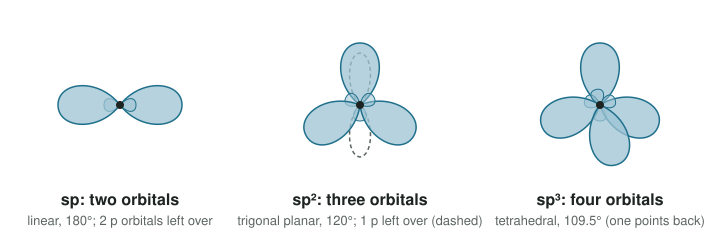
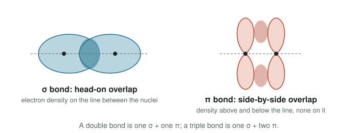

VSEPR predicts shapes but doesn't say how the electrons actually form bonds. **Valence-bond theory**
connects bonds to the atomic orbitals from Chapter 6.

## 1. Bonds form by orbital overlap (9.4)

A covalent bond forms when an orbital on one atom **overlaps** an orbital on another, and the two
electrons (one from each atom, with opposite spins) share the overlap region between the nuclei. Both
nuclei attract that shared pair.

How close do the atoms get? The graph shows the potential energy of two H atoms as they approach:

- **Far apart**, the atoms don't interact: energy is zero.
- **Closer**, the orbitals overlap and each nucleus attracts the other's electron, so the energy drops.
- **Too close**, the two positive nuclei (and the electrons) repel, and the energy shoots up.
- The **minimum** is the most stable distance. Its distance is the **bond length** (74 pm for H₂), and
  its depth below zero is the **bond energy** (436 kJ/mol), the energy needed to pull the atoms apart.

<Callout type="ap-tip">
This graph is AP topic 2.2. Compared with a weaker bond between the same atoms, a **higher bond
order** gives a **deeper** well (more energy to break) at a **shorter** distance. **Larger atoms** move
the minimum to a **longer** distance.
</Callout>

## 2. Hybrid orbitals (9.5)

Unhybridized atomic orbitals can't explain most shapes. Carbon's valence orbitals are one 2s and three
2p orbitals at 90° to each other, yet methane's four C–H bonds are identical and 109.5° apart.

The fix: the atom **mixes** some of its valence orbitals to make an equal number of new, identical
**hybrid orbitals** that point toward the electron domains.

| Electron domains | Hybridization | Orbitals mixed | Geometry | Left-over p orbitals | Example |
|---|---|---|---|---|---|
| 2 | **sp** | one s + one p | linear, 180° | 2 | Be in $\ce{BeF2}$, C in $\ce{CO2}$ |
| 3 | **sp²** | one s + two p | trigonal planar, 120° | 1 | B in $\ce{BF3}$, C in $\ce{H2CO}$ |
| 4 | **sp³** | one s + three p | tetrahedral, 109.5° | 0 | C in $\ce{CH4}$, N in $\ce{NH3}$, O in $\ce{H2O}$ |

**The number of hybrid orbitals equals the number of orbitals mixed**, which equals the number of
electron domains. Count domains (lone pairs count, and a multiple bond counts as one) and read off the
hybridization.

Questions about hybridization ask about **central or interior atoms** (any atom bonded to two or
more others). An outer atom such as an F in BF₃ isn't usually given a hybridization.

**Lone pairs sit in hybrid orbitals too.** The N in NH₃ is sp³: three of its sp³ orbitals form N–H
bonds and the fourth holds the lone pair.

<Reveal label="Worked example: how beryllium gets two bonds">

Be is $1s^2 2s^2$, with no unpaired electrons, so it seemingly can't bond. In $\ce{BeF2}$:

1. Imagine one 2s electron moving into an empty 2p orbital: now two unpaired electrons.
2. Mixing the 2s and that 2p makes **two sp hybrid orbitals**, pointing 180° apart.
3. Each sp orbital overlaps a 2p orbital of an F atom. The result is linear F–Be–F, which matches VSEPR.

</Reveal>

<Callout type="not-on-ap">
The AP exam asks you to name the hybridization (sp, sp², sp³) of an atom. It doesn't test how hybrid
orbitals are derived or drawn, or hybridization for five or six electron domains (sp³d, sp³d²).
</Callout>

## 3. Sigma and pi bonds (9.6)

There are two ways orbitals can overlap:

| | **Sigma (σ) bond** | **Pi (π) bond** |
|---|---|---|
| Overlap | head-on, along the line between the nuclei | side-by-side, between two parallel p orbitals |
| Electron density | on the axis between the nuclei | above and below the axis, none on it |
| Made from | hybrid orbitals, s orbitals, or end-on p orbitals | unhybridized p orbitals |
| Strength | stronger (more overlap) | weaker |

Every bond between two atoms has exactly **one σ bond**. Extra pairs are π bonds:

| Bond | σ | π |
|---|---|---|
| single | 1 | 0 |
| double | 1 | 1 |
| triple | 1 | 2 |

**Ethylene**, $\ce{H2C=CH2}$: each carbon is **sp²**. The sp² orbitals form the C–C σ bond and the four C–H
σ bonds, all in one plane. The leftover p orbital on each carbon points straight up and down, and the two
overlap side by side to form the **π bond**. Twisting one end would pull those p orbitals out of
alignment and break the π bond, so there is **no rotation around a double bond**, and the whole molecule
stays flat.

**Acetylene**, $\ce{HC#CH}$: each carbon is **sp**, with two leftover p orbitals at right angles. They form
**two π bonds**, so the triple bond is one σ and two π. The molecule is linear.

<Reveal label="Worked example: count σ and π bonds and name hybridizations">

Acrylonitrile is $\ce{H2C=CH-C#N}$ (three H atoms in all).

| Bonds | σ | π |
|---|---|---|
| 3 C–H | 3 | 0 |
| C=C | 1 | 1 |
| C–C | 1 | 0 |
| C≡N | 1 | 2 |
| **Total** | **6** | **3** |

Hybridization from domain counts:

- the CH₂ carbon: 3 domains (two C–H, one C=C), **sp²**
- the CH carbon: 3 domains (C–H, C=C, C–C), **sp²**
- the C of C≡N: 2 domains (C–C, C≡N), **sp**

</Reveal>

## 4. Delocalized π bonding

In a molecule with **resonance structures**, the π electrons aren't stuck between two atoms. In the
nitrate ion, $\ce{NO3-}$, the N is sp² and has one leftover p orbital, and each O has one too. All four
p orbitals overlap side by side, so the π electrons are spread over the **whole ion**. These are
**delocalized** π bonds, and they're the orbital picture of resonance.

**Benzene** is the best-known example. All six carbons are sp², so there's a p orbital on each one
pointing above and below the flat ring. The six π electrons spread around the whole ring, which is why
all six C–C bonds are identical.

<Callout type="warning">
σ bonds are localized between two atoms. Only π bonds can be delocalized, and only when resonance
structures show the double bond in more than one place.
</Callout>
