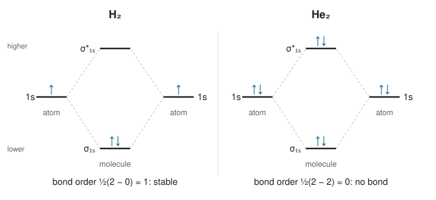
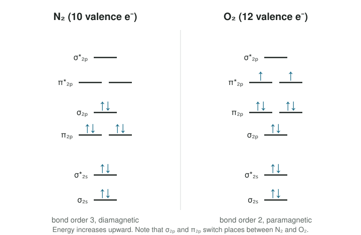

<Callout type="not-on-ap">
The AP exam doesn't test molecular orbital diagrams, filling molecular orbitals, or bonding vs.
antibonding orbitals. Learn this lesson for the class test.
</Callout>

Lewis structures and hybrid orbitals can't explain everything. The best-known failure is oxygen: its
Lewis structure, O=O, has every electron paired, but liquid oxygen sticks to a magnet, which means it has
**unpaired electrons**. **Molecular orbital (MO) theory** explains this.

## 1. Molecular orbitals (9.7)

In MO theory, electrons don't belong to one atom or one bond. They occupy **molecular orbitals** that
spread over the whole molecule. Like atomic orbitals, each MO holds at most **two electrons** with
opposite spins.

When two atomic orbitals combine, they always make **two** molecular orbitals:

| | **Bonding MO** | **Antibonding MO** (marked with *) |
|---|---|---|
| Energy | **lower** than the atomic orbitals | **higher** than the atomic orbitals |
| Electron density | concentrated **between** the nuclei | a **node** between the nuclei, density pushed to the outsides |
| Effect of electrons in it | holds the atoms together | pushes them apart |

For two 1s orbitals, these are $\sigma_{1s}$ and $\sigma^*_{1s}$.

### Bond order

$$
\text{bond order} = \tfrac{1}{2}\,(\text{bonding electrons} - \text{antibonding electrons})
$$

A bond order of 1, 2, or 3 matches a single, double, or triple bond. A bond order of **0** means the
molecule isn't stable. Fractional bond orders are allowed.

| Species | Configuration | Bond order | Exists? |
|---|---|---|---|
| $\ce{H2}$ | $(\sigma_{1s})^2$ | $\tfrac12(2 - 0) = 1$ | yes |
| $\ce{H2+}$ | $(\sigma_{1s})^1$ | $\tfrac12(1 - 0) = \tfrac12$ | yes, a weak bond |
| $\ce{He2+}$ | $(\sigma_{1s})^2(\sigma^*_{1s})^1$ | $\tfrac12(2 - 1) = \tfrac12$ | yes, a weak bond |
| $\ce{He2}$ | $(\sigma_{1s})^2(\sigma^*_{1s})^2$ | $\tfrac12(2 - 2) = 0$ | no |

He₂ doesn't form because the antibonding electrons cancel the bonding ones.

## 2. Period 2 diatomic molecules (9.8)

For Li₂ through Ne₂, only the **valence** orbitals matter (the 1s electrons fill both σ₁ₛ and σ\*₁ₛ and
cancel out). From the 2s orbitals you get σ₂ₛ and σ\*₂ₛ. From the six 2p orbitals you get six MOs:

- one **σ₂ₚ** and one **σ\*₂ₚ** (from the 2p orbitals pointing at each other), and
- two **π₂ₚ** and two **π\*₂ₚ** (from the 2p orbitals side by side; each pair has equal energy).

### The order switches after N₂

For **O₂, F₂, and Ne₂**, σ₂ₚ is lower in energy than π₂ₚ. For **B₂, C₂, and N₂**, the 2s and 2p
orbitals are close enough in energy to interact, which pushes σ₂ₚ **above** π₂ₚ.

Fill the diagram like atomic orbitals: lowest energy first, two per orbital, and **Hund's rule** for the
pairs of π orbitals (one electron in each before pairing).

| Molecule | Valence e⁻ | Configuration (valence) | Bond order | Unpaired e⁻ |
|---|---|---|---|---|
| $\ce{Li2}$ | 2 | $(\sigma_{2s})^2$ | 1 | 0 |
| $\ce{Be2}$ | 4 | $(\sigma_{2s})^2(\sigma^*_{2s})^2$ | 0 | (doesn't form) |
| $\ce{B2}$ | 6 | $\ldots(\pi_{2p})^2$ | 1 | **2** |
| $\ce{C2}$ | 8 | $\ldots(\pi_{2p})^4$ | 2 | 0 |
| $\ce{N2}$ | 10 | $\ldots(\pi_{2p})^4(\sigma_{2p})^2$ | 3 | 0 |
| $\ce{O2}$ | 12 | $\ldots(\sigma_{2p})^2(\pi_{2p})^4(\pi^*_{2p})^2$ | 2 | **2** |
| $\ce{F2}$ | 14 | $\ldots(\sigma_{2p})^2(\pi_{2p})^4(\pi^*_{2p})^4$ | 1 | 0 |
| $\ce{Ne2}$ | 16 | all bonding and antibonding filled | 0 | (doesn't form) |

As the bond order goes up from B₂ to N₂, the bonds get **stronger and shorter**. From N₂ to F₂ the bond
order drops, and the bonds get weaker and longer. N₂, with bond order 3, has one of the strongest bonds
known.

### Paramagnetism

- **Paramagnetic**: has **unpaired** electrons, so it's **attracted** into a magnetic field. B₂ and O₂.
- **Diamagnetic**: all electrons **paired**, so it's **weakly pushed out** of a magnetic field. C₂, N₂, F₂.

O₂ has two unpaired electrons, one in each π\*₂ₚ orbital. MO theory predicts this and the double bond
(bond order 2) at the same time, which is something the Lewis structure can't do.

### Molecules made of two different atoms

When the two atoms are different but close neighbors in period 2 (NO, CO, $\ce{CN-}$), the same diagram
works. Count the **total** valence electrons and fill from the bottom:

- **NO** has $5 + 6 = 11$ valence electrons, one more than $\ce{N2}$. The extra one goes alone into a
  π\*₂ₚ orbital, so the bond order is $\tfrac12(8 - 3) = 2.5$ and NO is paramagnetic.
- **CO** and $\ce{CN-}$ each have 10, the same as $\ce{N2}$ (they're **isoelectronic** with it), so each
  has bond order 3 and is diamagnetic.

<Reveal label="Worked example: O₂⁺, O₂⁻, and O₂²⁻">

Start from O₂ (12 valence electrons, bond order 2, two electrons in π\*₂ₚ) and change only the π\*₂ₚ
electrons:

| Species | Valence e⁻ | π\*₂ₚ electrons | Bond order | Paramagnetic? |
|---|---|---|---|---|
| $\ce{O2+}$ | 11 | 1 | $\tfrac12(8 - 3) = 2.5$ | yes |
| $\ce{O2}$ | 12 | 2 | $\tfrac12(8 - 4) = 2$ | yes |
| $\ce{O2-}$ | 13 | 3 | $\tfrac12(8 - 5) = 1.5$ | yes |
| $\ce{O2^2-}$ | 14 | 4 | $\tfrac12(8 - 6) = 1$ | no |

Bonding electrons stay at 8 (σ₂ₛ², σ₂ₚ², π₂ₚ⁴). Removing an antibonding electron **raises** the bond
order, so O₂⁺ has the **shortest, strongest** bond of the four and O₂²⁻ the longest and weakest.

</Reveal>

<Callout type="warning">
Count **valence** electrons only when you use the period 2 diagram. For an ion, add electrons for a
negative charge and subtract them for a positive one, then fill from the bottom.
</Callout>
