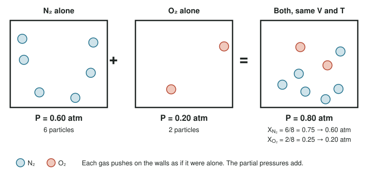

## 1. Dalton's law of partial pressures (10.5)

In a mixture of gases, each gas pushes on the walls as if the others weren't there. The pressure one gas
would exert alone in the same container is its **partial pressure**, and the total pressure is the sum:

$$
P_\text{total} = P_A + P_B + P_C + \ldots
$$

This works because gas particles are far apart and (in an ideal gas) don't attract or repel each other.
An $\ce{O2}$ molecule hits the wall just as often whether or not $\ce{N2}$ is in the box too.

Because each gas acts on its own, each one has its own ideal gas equation:

$$
P_A = \frac{n_A RT}{V}
$$

<Reveal label="Worked example: partial pressures from moles">

A 5.00 L container at 300. K holds 0.200 mol of $\ce{N2}$ and 0.0500 mol of $\ce{O2}$. Find each partial
pressure and the total.

$$
P_{\ce{N2}} = \frac{(0.200)(0.08206)(300.)}{5.00} = 0.985\ \text{atm} \qquad P_{\ce{O2}} = \frac{(0.0500)(0.08206)(300.)}{5.00} = 0.246\ \text{atm}
$$

$$
P_\text{total} = 0.985 + 0.246 = 1.231\ \text{atm}
$$

Using the total moles, 0.250 mol, in $PV = nRT$ gives the same total.

</Reveal>

## 2. Mole fractions (10.5)

The **mole fraction** of a gas is its share of the total moles:

$$
X_A = \frac{\text{moles of A}}{\text{total moles}}
$$

Mole fractions have no units, and they add up to 1. Since the pressure of each gas is proportional to its
moles,

$$
P_A = X_A \, P_\text{total}
$$

Both equations are on the equation sheet. A gas that makes up 25% of the molecules supplies 25% of the
pressure.

<Reveal label="Worked example: oxygen on a mountain">

Air is 21% $\ce{O2}$ by moles ($X_{\ce{O2}} = 0.21$). On a mountain where the air pressure is 0.830 atm, what
is the partial pressure of $\ce{O2}$?

$$
P_{\ce{O2}} = (0.21)(0.830\ \text{atm}) = 0.17\ \text{atm}
$$

That's less oxygen per breath than at sea level (0.21 atm), even though the air is still 21% oxygen.

</Reveal>

<Reveal label="Worked example: mole fraction from masses">

A tank holds 4.00 g of He and 16.0 g of $\ce{O2}$ at a total pressure of 2.50 atm. Find the partial
pressure of each gas.

**Moles:** $n_\text{He} = 4.00 / 4.003 = 0.999$ mol, and $n_{\ce{O2}} = 16.0 / 32.00 = 0.500$ mol. Total 1.499 mol.

**Mole fractions:** $X_\text{He} = 0.999 / 1.499 = 0.667$, and $X_{\ce{O2}} = 0.333$.

$$
P_\text{He} = (0.667)(2.50) = 1.67\ \text{atm} \qquad P_{\ce{O2}} = 2.50 - 1.67 = 0.83\ \text{atm}
$$

The $\ce{O2}$ is 80% of the **mass** but only a third of the **moles**, so it supplies only a third of the
pressure. Always convert to moles first.

</Reveal>

## 3. Changing a mixture

Two situations come up often.

**Adding a gas at constant volume and temperature.** The partial pressures of the gases already there
don't change, because their moles, the volume, and the temperature haven't changed. Only the total
pressure goes up, and the mole fractions of the original gases go down.

**Opening a valve between two containers.** Each gas spreads into the combined volume. Treat each gas
separately with Boyle's law ($P_1V_1 = P_2V_2$), then add.

<Reveal label="Worked example: two flasks joined">

A 2.00 L flask of He at 1.50 atm is connected through a valve to a 3.00 L flask of Ne at 0.800 atm, at the
same temperature. The valve is opened. Find each partial pressure, the total pressure, and the mole
fraction of He.

The combined volume is 5.00 L.

$$
P_\text{He} = \frac{(1.50)(2.00)}{5.00} = 0.600\ \text{atm} \qquad P_\text{Ne} = \frac{(0.800)(3.00)}{5.00} = 0.480\ \text{atm}
$$

$$
P_\text{total} = 1.080\ \text{atm} \qquad X_\text{He} = \frac{0.600}{1.080} = 0.556
$$

</Reveal>

## 4. Collecting a gas over water (10.5)

A gas made in a reaction is often collected by bubbling it into an upside-down bottle filled with water.
The gas pushes the water out. But the gas in the bottle isn't pure: water evaporates into it, so it's a
**mixture of the gas and water vapor**.

When the water level inside the bottle matches the level outside, the pressure inside equals the
atmospheric pressure. Then

$$
P_\text{gas} = P_\text{atm} - P_{\ce{H2O}}
$$

$P_{\ce{H2O}}$ is the **vapor pressure of water**, which depends only on the temperature. Questions give it.
A few values: 17.5 torr at 20 °C, 23.8 torr at 25 °C, and 31.8 torr at 30 °C.

<Reveal label="Worked example: hydrogen collected over water">

Zinc reacts with excess hydrochloric acid:

$$
\ce{Zn(s) + 2HCl(aq) -> ZnCl2(aq) + H2(g)}
$$

The $\ce{H2}$ is collected over water at 25.0 °C. It fills 245 mL when the atmospheric pressure is 758 torr.
The vapor pressure of water at 25.0 °C is 23.8 torr. What mass of zinc reacted?

**Pressure of H₂ alone:** $758 - 23.8 = 734.2$ torr, and $734.2 / 760 = 0.9661$ atm.

**Moles of H₂:**

$$
n = \frac{PV}{RT} = \frac{(0.9661)(0.245)}{(0.08206)(298.15)} = 9.67 \times 10^{-3}\ \text{mol}
$$

**Mass of Zn:** 1 mol Zn makes 1 mol $\ce{H2}$, so
$(9.67 \times 10^{-3}\ \text{mol})(65.38\ \text{g/mol}) = 0.633$ g.

</Reveal>

<Callout type="ap-tip">
If a student forgets to subtract the water vapor pressure, the pressure used for the gas is too high, so
the calculated moles of gas come out **too high**. Follow that through whatever the question asks: in the
example above, the calculated mass of zinc would be too high (0.653 g instead of 0.633 g).
</Callout>
