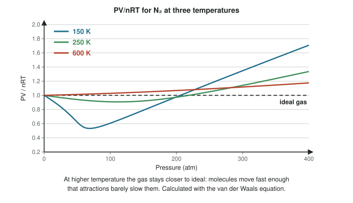

The ideal gas law rests on two assumptions from [kinetic-molecular theory](../10-kinetic-molecular-theory/)
that are never exactly true: gas particles take up no space, and they don't attract each other. At room
temperature and about 1 atm, the errors are small. At high pressure or low temperature, they aren't.

## 1. Measuring how far a gas is from ideal (10.8)

For an ideal gas, $\dfrac{PV}{nRT} = 1$ exactly, at every pressure. For a real gas, measure $P$, $V$, $n$,
and $T$ and calculate the same ratio. The further it is from 1, the less ideal the gas.

Two things pull the ratio in opposite directions.

## 2. Attractions make the pressure lower than ideal

Real molecules attract each other (these attractions are the intermolecular forces of Chapter 11). A
molecule about to hit the wall is pulled back slightly by the molecules behind it, so it hits the wall
with less force. Molecules that are attracted to each other also spend a little time close together,
which cuts down how often they hit the wall. Either way, the **measured pressure is lower** than
$PV = nRT$ predicts, and $PV/nRT$ drops **below 1**.

Attractions matter most when

- the **temperature is low**, because slow molecules are pulled off course more easily, and
- the gas is **close to condensing** into a liquid. Condensation is what happens when the attractions win.

## 3. Particle volume makes the pressure higher than ideal

The $V$ in $PV = nRT$ assumes the whole container is empty space the particles can move through. Real
particles take up some of it. At low pressure that share is tiny. At **very high pressure**, the particles
are packed so close that their own volume is a real fraction of the container. The free space is smaller
than $V$, collisions with the walls are more frequent than the model predicts, and the **measured pressure
is higher** than ideal. $PV/nRT$ rises **above 1**.

That's why the curves in the first graph dip and then rise. At moderate pressures the attractions win.
At very high pressures the particle volume wins.

## 4. When are gases most nearly ideal?

**High temperature and low pressure.**

- **Low pressure:** the particles are far apart, so their volume is a negligible share of the container,
  and they're rarely close enough to attract each other.
- **High temperature:** the particles move so fast that the brief tug from a neighbor hardly changes
  their motion.

The opposite conditions, **low temperature and high pressure**, give the biggest deviations.

## 5. Which gases deviate most?

At the same conditions, a gas deviates more when its particles **attract each other more strongly** or are
**bigger**.

- **Polar molecules** attract each other more than nonpolar ones of similar size. $\ce{NH3}$ (polar) deviates
  more than $\ce{CH4}$ (nonpolar), though they have nearly the same molar mass.
- **Larger molecules with more electrons** attract each other more strongly, even when nonpolar, and they
  also take up more space. $\ce{CO2}$ deviates more than $\ce{N2}$, and Xe more than He.
- **Small, nonpolar particles with few electrons**, like He and $\ce{H2}$, behave most nearly ideally.

<Reveal label="Worked example: explaining a deviation">

**Question:** At 300 K and 5.0 atm, one mole of $\ce{NH3}$ takes up a smaller volume than one mole of
$\ce{CH4}$. Explain.

**Answer:** $\ce{NH3}$ molecules are polar and attract each other more strongly than nonpolar $\ce{CH4}$
molecules do. (Chapter 11 will show that $\ce{NH3}$ forms hydrogen bonds.) The stronger attractions pull
the $\ce{NH3}$ molecules closer together, so the gas deviates more from ideal behavior and takes up less
volume than an ideal gas would at the same pressure.

</Reveal>

<Callout type="ap-tip">
A complete explanation connects a particle-level cause to the measured result: "the attractions between
the molecules reduce the force (and frequency) of their collisions with the walls, so the measured
pressure is lower than the pressure calculated with the ideal gas law." Naming just "intermolecular forces"
or "non-ideal behavior" doesn't earn the point.
</Callout>

## 6. The van der Waals equation (10.8)

<Callout type="not-on-ap">
The AP exam asks for the qualitative reasoning above, not the van der Waals equation. It's in the textbook
and may be on the class test.
</Callout>

The **van der Waals equation** corrects $PV = nRT$ for both effects:

$$
\left(P + \frac{an^2}{V^2}\right)(V - nb) = nRT
$$

- $a$ corrects for **attractions**. The measured $P$ is too low, so a term is added to it. Gases with
  stronger attractions have larger $a$.
- $b$ corrects for **particle volume**: each mole takes up $b$ liters, so the free space is $V - nb$.
  Bigger particles have larger $b$.

| Gas | $a$ (L²·atm/mol²) | $b$ (L/mol) |
|---|---|---|
| He | 0.0341 | 0.0238 |
| $\ce{H2}$ | 0.244 | 0.0266 |
| $\ce{N2}$ | 1.35 | 0.0387 |
| $\ce{CH4}$ | 2.25 | 0.0428 |
| $\ce{CO2}$ | 3.59 | 0.0427 |
| $\ce{NH3}$ | 4.17 | 0.0371 |
| $\ce{H2O}$ | 5.46 | 0.0305 |

These are standard reference values. The pattern in $a$ follows the attractions: tiny for He, larger for
bigger molecules, and largest for the polar $\ce{NH3}$ and $\ce{H2O}$.

<Reveal label="Worked example: CO₂ in a small container">

What pressure does 1.00 mol of $\ce{CO2}$ exert in 0.500 L at 300. K? Compare the ideal gas law with the
van der Waals equation.

**Ideal:**

$$
P = \frac{nRT}{V} = \frac{(1.00)(0.08206)(300.)}{0.500} = 49.2\ \text{atm}
$$

**van der Waals**, solved for $P$:

$$
P = \frac{nRT}{V - nb} - \frac{an^2}{V^2} = \frac{(1.00)(0.08206)(300.)}{0.500 - 0.0427} - \frac{(3.59)(1.00)^2}{(0.500)^2} = 53.8 - 14.4 = 39.5\ \text{atm}
$$

The volume correction alone would raise the pressure to 53.8 atm, but the attraction correction lowers it
by 14.4 atm. At these conditions attractions win, and the real pressure is about 20% lower than ideal.

</Reveal>
