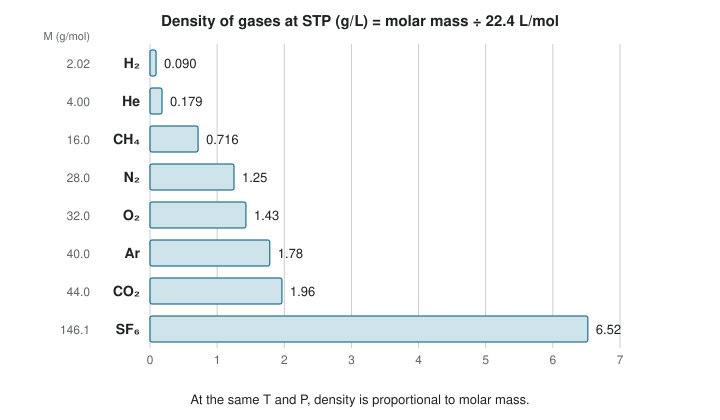

## 1. PV = nRT (10.4)

Boyle's, Charles's, and Avogadro's laws all fit into one equation, the **ideal gas equation**:

$$
PV = nRT
$$

$R$ is the **gas constant**. An **ideal gas** is one that obeys this equation exactly. No real gas does,
but at ordinary temperatures and pressures most come within a few percent. The
[Real Gases lesson](../10-real-gases/) covers when they don't.

The equation sheet gives two values of $R$. Pick the one whose units match your data:

| $R$ | Use with |
|---|---|
| 0.08206 L·atm/(mol·K) | $P$ in **atm**, $V$ in **L** (the usual choice) |
| 8.314 J/(mol·K) | $P$ in **kPa** with $V$ in **L**, or $P$ in Pa with $V$ in m³ (1 kPa·L = 1 J) |

Whichever you use, $T$ is in kelvins and $n$ in moles. Convert torr or mm Hg to atm, and mL to L, before you
substitute.

<Reveal label="Worked example: moles of gas in a flask">

A 2.50 L flask holds a gas at 1.45 atm and 25.0 °C. How many moles of gas are in it?

$$
n = \frac{PV}{RT} = \frac{(1.45\ \text{atm})(2.50\ \text{L})}{(0.08206\ \text{L·atm/(mol·K)})(298.15\ \text{K})} = \frac{3.625}{24.47} = 0.148\ \text{mol}
$$

</Reveal>

<Reveal label="Worked example: volume of a mass of gas">

What volume does 12.0 g of $\ce{O2}$ take up at 35 °C and 0.950 atm?

Moles first: $n = 12.0\ \text{g} / 32.00\ \text{g/mol} = 0.375$ mol.

$$
V = \frac{nRT}{P} = \frac{(0.375)(0.08206)(308.15)}{0.950} = 9.98\ \text{L}
$$

</Reveal>

## 2. STP and molar volume

**Standard temperature and pressure (STP)** is 273.15 K (0 °C) and 1 atm. At STP, one mole of any ideal
gas takes up

$$
V = \frac{nRT}{P} = \frac{(1)(0.08206)(273.15)}{1} = 22.4\ \text{L}
$$

The equation sheet gives both STP and the 22.4 L/mol molar volume. Use 22.4 L/mol **only at STP**. At
any other conditions, use $PV = nRT$.

## 3. Connecting PV = nRT to the gas laws (10.4)

Rearranged, the ideal gas equation says $\dfrac{PV}{nT} = R$, a constant. So for one sample in two
situations,

$$
\frac{P_1V_1}{n_1T_1} = \frac{P_2V_2}{n_2T_2}
$$

Cross out whatever stays constant and you get Boyle's law, Charles's law, Avogadro's law, or the combined
gas law. If a problem gives you one set of conditions and asks about another, use this ratio form. If it
gives you one set and asks for $n$, $V$, $P$, or $T$ directly, use $PV = nRT$.

## 4. Gas density and molar mass (10.4)

Substitute $n = m/\mathcal{M}$ (mass over molar mass, on the equation sheet) into $PV = nRT$:

$$
PV = \frac{m}{\mathcal{M}}RT \quad\Longrightarrow\quad d = \frac{m}{V} = \frac{P\mathcal{M}}{RT}
$$

You don't need to memorize this. It comes straight from the two equations on the sheet. What it says:

- At the same $T$ and $P$, a gas's **density is proportional to its molar mass**.
- Raising the temperature (at constant pressure) **lowers** the density. That's why hot air rises.
- Raising the pressure raises the density.

<Reveal label="Worked example: density of CO₂">

What is the density of $\ce{CO2}$ at 1.00 atm and 25 °C?

$$
d = \frac{P\mathcal{M}}{RT} = \frac{(1.00)(44.01)}{(0.08206)(298.15)} = 1.80\ \text{g/L}
$$

Air is about 1.2 g/L at these conditions, so $\ce{CO2}$ sinks in air and collects in low places.

</Reveal>

<Reveal label="Worked example: molar mass of an unknown gas">

A 250.0 mL flask is filled with an unknown gas at 22.0 °C and 745 torr. The gas has a mass of 0.345 g.
What is its molar mass?

Convert: $P = 745/760 = 0.9803$ atm, $V = 0.2500$ L, $T = 295.15$ K.

Moles from $PV = nRT$:

$$
n = \frac{(0.9803)(0.2500)}{(0.08206)(295.15)} = 0.01012\ \text{mol}
$$

Then

$$
\mathcal{M} = \frac{m}{n} = \frac{0.345\ \text{g}}{0.01012\ \text{mol}} = 34.1\ \text{g/mol}
$$

That matches $\ce{H2S}$ (34.08 g/mol).

</Reveal>

<Callout type="ap-tip">
Lab questions ask how an error changes a molar mass found this way. Follow it through
$\mathcal{M} = mRT/PV$. If some of the gas leaks out before weighing, $m$ is too small, so $\mathcal{M}$
comes out too small. If the flask isn't dry and the water's mass is counted as gas, $m$ is too big, so
$\mathcal{M}$ is too big.
</Callout>

## 5. Gas stoichiometry (10.4, AP topic 4.5)

Gas volumes enter stoichiometry the same way masses do: convert to moles, use the mole ratio from the
balanced equation, and convert back.

<Reveal label="Worked example: an airbag">

Airbags inflate when sodium azide decomposes:

$$
\ce{2NaN3(s) -> 2Na(s) + 3N2(g)}
$$

What volume of $\ce{N2}$ does 65.0 g of $\ce{NaN3}$ make at 25 °C and 1.00 atm?

**Moles of NaN₃:** $\mathcal{M} = 22.99 + 3(14.01) = 65.02$ g/mol, so $65.0 / 65.02 = 1.000$ mol.

**Moles of N₂:** $1.000\ \text{mol NaN}_3 \times \dfrac{3\ \text{mol N}_2}{2\ \text{mol NaN}_3} = 1.500$ mol.

**Volume:**

$$
V = \frac{nRT}{P} = \frac{(1.500)(0.08206)(298.15)}{1.00} = 36.7\ \text{L}
$$

</Reveal>

When every substance you're comparing is a gas at the **same temperature and pressure**, you can skip
moles. By Avogadro's law, volumes are proportional to moles, so the coefficients give volume ratios
directly.

<Reveal label="Worked example: volumes only">

$$
\ce{N2(g) + 3H2(g) -> 2NH3(g)}
$$

At the same temperature and pressure, how much $\ce{N2}$ reacts with 6.0 L of $\ce{H2}$, and how much
$\ce{NH3}$ forms?

$$
6.0\ \text{L H}_2 \times \frac{1\ \text{L N}_2}{3\ \text{L H}_2} = 2.0\ \text{L N}_2 \qquad 6.0\ \text{L H}_2 \times \frac{2\ \text{L NH}_3}{3\ \text{L H}_2} = 4.0\ \text{L NH}_3
$$

Notice that 8.0 L of gas became 4.0 L. Volume isn't conserved in a reaction; mass is.

</Reveal>

<Callout type="warning">
The volume shortcut works only for gases at the same $T$ and $P$. It never works for solids, liquids, or
solutions, and it doesn't convert a gas volume to a mass. For those, go through moles.
</Callout>
