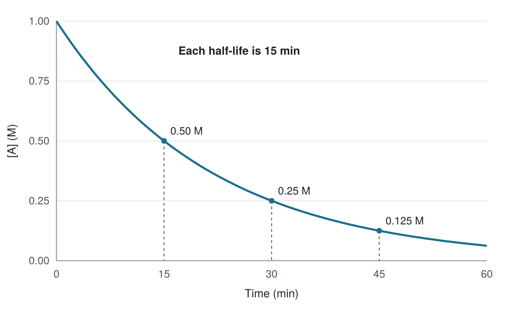

Kinetics asks **how fast** a reaction happens, not how far it goes. This lesson covers three
connected ideas: how to write a rate, how a rate depends on concentration (the rate law), and how
concentration changes over time (integrated rate laws).

## 1. Writing a reaction rate

A rate is a change in concentration per unit time. Different species in the same reaction change at
different speeds, so we divide by each coefficient to get **one** rate for the reaction. For the
formation of water,

$$
\ce{2H2 + O2 -> 2H2O}
$$

$$
\text{rate} = -\frac{1}{2}\frac{\Delta[\ce{H2}]}{\Delta t} = -\frac{\Delta[\ce{O2}]}{\Delta t} = +\frac{1}{2}\frac{\Delta[\ce{H2O}]}{\Delta t}
$$

<Callout type="note">
Reactant concentrations go down, so their $\Delta[\ ]$ is negative. The minus sign makes the rate a
positive number. A reaction rate is always reported as positive.
</Callout>

So if $\ce{O2}$ is used up at $0.020\ \text{M/s}$, then $\ce{H2}$ is used up at $0.040\ \text{M/s}$
and $\ce{H2O}$ forms at $0.040\ \text{M/s}$.

## 2. Rate laws

A rate law shows how the rate depends on reactant concentrations:

$$
\text{rate} = k[\mathrm{A}]^m[\mathrm{B}]^n
$$

Here $k$ is the rate constant (it changes with temperature, not with concentration), and $m$ and $n$
are the **orders** with respect to A and B. The overall order is $m + n$.

<Callout type="warning">
Orders come from **experimental data**, not from the coefficients in the overall balanced equation.
You can only read orders straight from coefficients for a single elementary step (topic 5.4).
</Callout>

### Method of initial rates

Run the reaction several times, change one starting concentration at a time, and compare the
initial rates. If doubling $[\mathrm{A}]$ multiplies the rate by $2^m$, the order in A is $m$:

| Rate change when [A] doubles | Order in A |
|---|---|
| No change ($\times 1$) | 0 |
| Doubles ($\times 2$) | 1 |
| Quadruples ($\times 4$) | 2 |

The units of $k$ depend on the overall order: $\text{M s}^{-1}$ for zero order, $\text{s}^{-1}$
for first order, and $\text{M}^{-1}\,\text{s}^{-1}$ for second order. The units are always whatever
makes the rate come out in $\text{M s}^{-1}$.

<Reveal label="Worked example: find the rate law">

For $\mathrm{A} + \mathrm{B} \rightarrow \text{products}$:

| Trial | [A] (M) | [B] (M) | Initial rate (M/s) |
|---|---|---|---|
| 1 | 0.050 | 0.050 | $3.0 \times 10^{-4}$ |
| 2 | 0.100 | 0.050 | $6.0 \times 10^{-4}$ |
| 3 | 0.050 | 0.150 | $2.7 \times 10^{-3}$ |

- Trials 1 → 2: [A] doubles and the rate doubles, so the reaction is **first order in A**.
- Trials 1 → 3: [B] triples and the rate goes up by $2.7 \times 10^{-3} / 3.0 \times 10^{-4} = 9 = 3^2$, so it is **second order in B**.

Rate law: $\text{rate} = k[\mathrm{A}][\mathrm{B}]^2$, third order overall.

From trial 1: $k = \dfrac{3.0 \times 10^{-4}}{(0.050)(0.050)^2} = 2.4\ \text{M}^{-2}\,\text{s}^{-1}$.

</Reveal>

## 3. Concentration over time

Integrated rate laws connect concentration to time. Each one is a straight-line equation, so the order
can be identified by finding which plot is linear:

| Order | Integrated rate law | Linear plot | Slope |
|---|---|---|---|
| 0 | $[\mathrm{A}]_t - [\mathrm{A}]_0 = -kt$ | $[\mathrm{A}]$ vs. $t$ | $-k$ |
| 1 | $\ln[\mathrm{A}]_t - \ln[\mathrm{A}]_0 = -kt$ | $\ln[\mathrm{A}]$ vs. $t$ | $-k$ |
| 2 | $\dfrac{1}{[\mathrm{A}]_t} - \dfrac{1}{[\mathrm{A}]_0} = kt$ | $1/[\mathrm{A}]$ vs. $t$ | $+k$ |

<Callout type="ap-tip">
All three integrated rate laws and the half-life equation are on the AP equation sheet. What the exam
tests is choosing the right one: look for the linear plot, or check whether the half-life stays constant.
</Callout>

### Half-life of a first-order reaction

For a first-order reaction the half-life does not depend on concentration:

$$
t_{1/2} = \frac{\ln 2}{k} = \frac{0.693}{k}
$$

The graph below shows a first-order reaction starting at $1.00\ \text{M}$. Every 15 minutes, half of
whatever is left reacts.

<Reveal label="Worked example: use the half-life">

**What is $k$?** $k = 0.693 / 15\ \text{min} = 0.0462\ \text{min}^{-1}$.

**What is [A] after 60 minutes?** 60 min is four half-lives, so
$[\mathrm{A}] = 1.00\ \text{M} \times \left(\tfrac{1}{2}\right)^4 = 0.0625\ \text{M}$.

Check with the integrated rate law: $\ln[\mathrm{A}]_t = \ln(1.00) - (0.0462)(60) = -2.77$, and
$e^{-2.77} = 0.0625\ \text{M}$.

</Reveal>

Radioactive decay is a common real example of first-order kinetics, which is why half-lives are quoted
for isotopes.

<Callout type="not-on-ap">
Calculations with the Arrhenius equation, $k = Ae^{-E_a/RT}$, are not assessed on the AP exam. You still
need to explain qualitatively why raising the temperature increases the rate (topics 5.5 and 5.6).
</Callout>

## Video

This video works through initial-rate problems and integrated rate laws.

<YouTube id="wYqQCojggyM" title="Kinetics: Initial Rates and Integrated Rate Laws (Professor Dave Explains)" />
